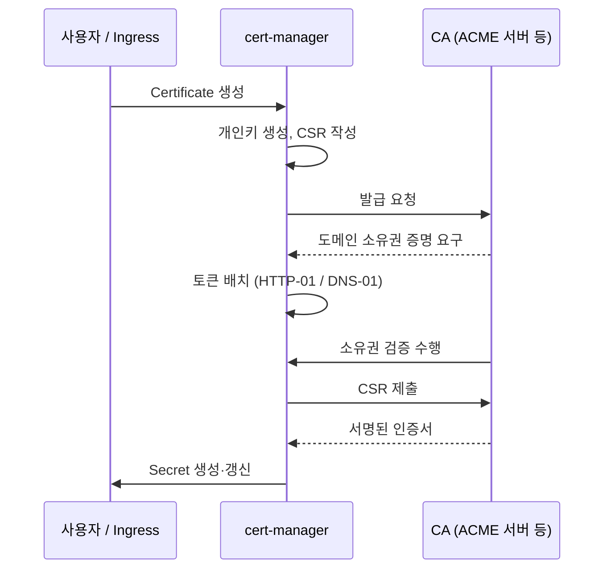

# 1. cert-manager

## 1-1. cert-manager 개요

cert-manager는 쿠버네티스에서 X.509 인증서의 발급과 갱신을 자동화하는 컨트롤러다.

> **X.509**: 공개키 인증서의 형식을 정의한 표준(RFC 5280). 인증서에 어떤 항목이 어떤 구조로 들어가는지를 규정한다. 주체(도메인), 공개키, 발급자, 유효기간, 발급자의 서명 등이 여기에 포함된다. TLS/HTTPS에서 쓰는 인증서는 모두 X.509 형식이다. 상세는 2장에서 다룬다.

- 2017년 Jetstack이 kube-lego의 후속으로 시작했고, 이후 CNCF에 기부되어 2024년 Graduated 단계에 올랐다. 쿠버네티스 환경의 인증서 관리에서 사실상 표준으로 쓰인다

> **Jetstack**: 영국의 쿠버네티스 전문 회사(2015년 설립). cert-manager를 만들어 오픈소스로 공개했다. 2020년 인증서 관리 솔루션 업체 Venafi에 인수됐고, Venafi는 2024년 CyberArk에 인수됐다. 프로젝트 자체는 CNCF로 넘어가 특정 벤더에 종속되지 않는다. [jetstack.io](https://www.jetstack.io/)
>
> **kube-lego**: Jetstack이 2016년에 만든 오픈소스 프로젝트. 쿠버네티스 Ingress에 Let's Encrypt 인증서를 자동으로 발급해 붙이는 역할만 했다. Let's Encrypt와 nginx Ingress에만 동작하고 발급 주체를 바꿀 수 없는 구조였다. cert-manager가 이를 일반화하면서 2018년 보관 종료됐다. [github.com/jetstack/kube-lego](https://github.com/jetstack/kube-lego)
- 쿠버네티스 컨트롤러로 동작한다. CRD로 "필요한 인증서"를 선언하면 컨트롤러가 발급 과정을 수행하고, 결과를 `Secret`으로 만들어 둔다. 이후 만료가 가까워지면 같은 과정을 다시 수행한다
- 발급 주체를 추상화한다. Let's Encrypt 같은 공인 CA(ACME), 사내 CA, HashiCorp Vault, 자체 서명 등 어디서 발급받든 사용하는 쪽 인터페이스는 동일한 `Secret`이다
- 인증서를 사용하는 쪽과는 느슨하게 연결된다. Ingress나 Gateway 리소스에 어노테이션을 달아두면 필요한 인증서 리소스가 자동으로 만들어진다

정리하면, 인증서 수명 주기 중에서 **발급과 갱신**을 담당한다. 발급된 인증서를 실제로 트래픽에 적용하는 일은 하지 않는다.

## 1-2. 등장 배경

**인증서에는 수명이 있다.**

인증서는 유효기간이 정해진 파일이다. 만료되면 클라이언트는 접속을 거부한다. 즉 인증서를 쓰는 서비스라면 주기적인 교체가 반드시 필요하다.

**수동 관리의 한계**

교체를 사람이 하면 다음 문제가 남는다.

- 만료를 감시하는 주체가 없다. 달력이나 개인 메모에 의존한다
- 교체 자체가 수작업이다. 발급, 파일 배포, 리로드가 각각 수동이고 절차가 서비스마다 다르다
- 담당자가 바뀌면 절차와 만료일 정보가 함께 사라진다

이 방식은 인증서 수가 적고 수명이 길 때만 유지된다.

**수명 단축 추세**

공인 인증서의 최대 유효기간은 계속 줄어왔다. Baseline Requirements 초기에는 60개월이었고, 이후 39개월 → 825일 → 398일로 줄였다. Let's Encrypt는 처음부터 90일을 채택했다.

- [Ballot 185: Limiting the Lifetime of Certificates (2017)](https://cabforum.org/2017/02/24/ballot-185-limiting-the-lifetime-of-certificates/) — 825일로 단축
- [Ballot SC22: Reduce Certificate Lifetimes (2019)](https://cabforum.org/2019/09/10/ballot-sc22-reduce-certificate-lifetimes-v2/) — 398일로 단축

2025년 4월 CA/Browser Forum이 Ballot SC-081v3을 통과시키면서 추가 단축 일정이 확정됐다.

> **CA/Browser Forum**: 인증기관(CA)과 브라우저・OS 벤더가 참여하는 협의체(2005년 발족). 공인 인증서의 발급 기준을 정한 Baseline Requirements를 관리한다. ISO나 IETF 같은 공식 표준화 기구는 아니고 법적 강제력도 없지만, Chrome・Firefox・Apple・Microsoft의 루트 프로그램이 "Baseline Requirements 준수"를 신뢰 저장소 등재 조건으로 걸기 때문에 사실상 강제된다. 위반한 CA는 신뢰 저장소에서 제거된다. 변경은 Ballot 투표로 결정된다. [cabforum.org](https://cabforum.org/)

| 시점 | 최대 유효기간 |
|---|---|
| 2026-03-15 | 200일 |
| 2027-03-15 | 100일 |
| 2029-03-15 | 47일 |

- [Ballot SC-081v3: Introduce Schedule of Reducing Validity and Data Reuse Periods](https://cabforum.org/2025/04/11/ballot-sc081v3-introduce-schedule-of-reducing-validity-and-data-reuse-periods/)

수명이 짧아진 이유는 폐기(revocation) 메커니즘이 실효성 있게 동작하지 않기 때문이다. 유출된 인증서를 확실히 무효화할 방법이 마땅치 않으니, 대신 인증서 자체를 빨리 만료시키는 쪽을 택했다.

그 결과 교체 주기가 사람이 감당할 수 있는 범위를 벗어났다. 자동화는 선택이 아니라 전제가 됐다.

**쿠버네티스와 마이크로서비스**

여기에 두 가지가 더해졌다.

- 관리 대상 수의 증가. 서비스마다 도메인이 생기고, 내부 통신까지 TLS로 감싸면 인증서 수는 서비스 수만큼 늘어난다
- 인프라의 가변성. 파드는 수시로 생성되고 사라진다. 특정 서버에 인증서 파일을 올려두는 모델이 성립하지 않는다

**왜 자동화가 아니면 안 되는가**

지금까지 본 것을 합치면 세 가지 변화가 같은 시기에 겹쳤다.

| 축 | 변화 | 작업량에 미치는 영향 |
|---|---|---|
| 갱신 주기 | 398일 → 200일 → 47일 | 인증서 하나당 연 1회에서 연 8회로 |
| 관리 대상 수 | 서비스마다 도메인, 내부 통신까지 TLS | 인증서 수가 서비스 수만큼 늘어남 |
| 대상의 가변성 | 파드는 수시로 생성·소멸 | 특정 서버에 파일을 두는 모델이 성립하지 않음 |

작업량은 **인증서 수 × 연간 갱신 횟수**로 늘어난다. 서비스 30개에 47일 인증서면 연 240회다. 사람이 달력으로 관리할 수 있는 규모가 아니다.

셋 중 하나만 있었다면 자동화가 필수는 아니었다. 인증서가 한 장뿐이면 47일 주기도 감당할 수 있고, 수명이 2년이면 서비스가 많아도 버틸 수 있으며, 서버가 고정되어 있으면 파일을 올려두는 방식이 통한다. 세 가지가 겹쳤기 때문에 자동화가 선택이 아니라 전제가 됐다.

**선언적 모델로의 전환**

쿠버네티스는 "원하는 상태를 선언하면 컨트롤러가 그 상태로 수렴시킨다"는 모델을 쓴다. 인증서 관리도 같은 방식으로 옮길 수 있다.

- 선언: 이 도메인의 유효한 인증서가 이 `Secret`에 존재해야 한다
- 수렴: 없으면 발급하고, 만료가 가까우면 갱신한다

cert-manager는 이 수렴 루프를 담당하는 컨트롤러다.

## 1-3. 구성 요소

cert-manager는 자체 리소스 타입(CRD)을 쿠버네티스 API에 등록한다. 인증서 관리에 필요한 개념이 각각 하나의 리소스로 대응된다.

| 개념 | 리소스 | 생성 주체 |
|---|---|---|
| 인증기관 | `Issuer` / `ClusterIssuer` | 사용자 |
| 필요한 인증서 | `Certificate` | 사용자 (또는 ingress-shim) |
| 발급 요청 | `CertificateRequest` | cert-manager |
| 소유권 검증 | `Order` / `Challenge` | cert-manager |
| 결과물 | `Secret` | cert-manager |

사용자가 직접 다루는 것은 위쪽 두 개다. 나머지는 cert-manager가 발급 과정에서 만들고 지우는 중간 산출물이다.

### Issuer / ClusterIssuer

인증서를 어디서 발급받을지를 정의한다. 둘의 차이는 유효 범위뿐이고 스펙은 동일하다.

- `Issuer`: 네임스페이스 범위. 같은 네임스페이스의 `Certificate`만 참조할 수 있다
- `ClusterIssuer`: 클러스터 범위. 모든 네임스페이스에서 참조할 수 있다. 참조하는 `Secret`(ACME 계정 키, CA 키 등)은 cert-manager가 설치된 네임스페이스에서 찾는다

발급 방식에 따라 타입이 나뉜다.

| 타입 | 발급 주체 | 용도 |
|---|---|---|
| `acme` | Let's Encrypt 등 ACME 지원 CA | 공인 인증서. 외부에 노출되는 도메인 |
| `ca` | 클러스터 내 `Secret`에 보관된 CA 키·인증서 | 사내 인증서, mTLS |
| `selfSigned` | 없음. 자기 자신이 서명 | 테스트, 그리고 사내 Root CA를 만들 때의 시작점 |
| `vault`, `venafi` | 외부 인증서 관리 시스템 | 별도 인프라가 있는 경우 |

> **`vault`는 Azure Key Vault가 아니다**: 여기서 `vault`는 HashiCorp Vault의 PKI 시크릿 엔진을 가리킨다. cert-manager에는 Azure Key Vault용 내장 Issuer 타입이 없다. Key Vault는 통합 CA(DigiCert, GlobalSign)를 통해 자체적으로 발급・갱신까지 수행하므로, cert-manager의 백엔드가 아니라 대안에 가깝다. 쿠버네티스에서 Key Vault 인증서를 쓰려면 Secrets Store CSI Driver로 `Secret`을 동기화하거나 AKS app routing add-on의 어노테이션을 쓴다. 둘 다 cert-manager 경로가 아니다.
>
> 마찬가지로 1-4의 DNS-01 예시에 나오는 `azureDNS`도 Issuer 타입이 아니라 **solver**다. 발급은 Let's Encrypt가 하고, Azure DNS는 TXT 레코드를 놓을 장소일 뿐이다.

여기서 `acme`와 `ca`의 차이는 발급 능력이 아니라 신뢰 범위다. CA가 되는 데 필요한 것은 개인키와 `CA:TRUE`인 인증서뿐이므로, 조직이 자체 CA를 운영하는 것도 가능하다. Let's Encrypt는 그중 Root 인증서가 브라우저·OS 신뢰 저장소에 등재된 공인 CA다.

| | 공인 CA (`acme`) | 사내 CA (`ca`) |
|---|---|---|
| Root의 위치 | 브라우저·OS 신뢰 저장소에 이미 있음 | 조직이 클라이언트에 직접 배포해야 함 |
| 도메인 소유권 검증 | 필요. CA가 신청자를 모른다 | 불필요. CA가 곧 조직 자신이다 |
| 발급 가능한 이름 | 인터넷에 등록된 도메인만 | 제약 없음 |

공인 CA가 발급한 인증서는 전 세계 클라이언트가 신뢰하므로, CA는 발급 전에 신청자가 그 도메인을 통제하는지 스스로 확인해야 한다. 확인 통로는 인터넷에서 도달 가능한 경로뿐이다. 이것이 1-4의 도메인 소유권 검증이 필요한 이유이고, 사내 DNS에만 존재하는 이름에 공인 인증서를 받을 수 없는 이유이기도 하다. `*.local`이나 `server01.internal` 같은 이름은 소유권 개념 자체가 없어 공인 CA의 발급이 금지되어 있다.

```yaml
apiVersion: cert-manager.io/v1
kind: ClusterIssuer
metadata:
  name: letsencrypt-prod
spec:
  acme:
    server: https://acme-v02.api.letsencrypt.org/directory
    email: admin@example.com
    privateKeySecretRef:
      name: letsencrypt-prod-account-key   # 계정 키. cert-manager가 생성해 저장
    solvers:
      - http01:
          ingress:
            ingressClassName: nginx
```

`solvers`는 도메인 소유권을 어떻게 증명할지를 정의한다. ACME 타입에만 해당하며, 상세는 1-4에서 다룬다.

### Certificate

원하는 인증서의 상태를 선언한다.

```yaml
apiVersion: cert-manager.io/v1
kind: Certificate
metadata:
  name: app-tls
  namespace: default
spec:
  secretName: app-tls          # 결과물이 저장될 Secret 이름
  dnsNames:
    - app.example.com          # 인증서의 SAN
  issuerRef:
    name: letsencrypt-prod
    kind: ClusterIssuer
  duration: 2160h              # 요청할 유효기간 (90일). CA가 거부할 수 있다
  renewBefore: 720h            # 만료 30일 전 갱신
```

- `dnsNames`가 인증서의 SAN이 된다. 여러 개를 넣으면 하나의 인증서로 여러 도메인을 처리한다

> **SAN (Subject Alternative Name)**: 인증서가 유효한 도메인 목록을 담는 필드. 클라이언트는 접속하려는 호스트명이 이 목록에 있는지 확인하고, 없으면 연결을 거부한다. `app.example.com`처럼 개별 도메인을 여러 개 나열하거나 `*.example.com` 같은 와일드카드를 쓸 수 있다. 과거에는 Subject의 CN 필드를 썼지만 현재 브라우저는 CN을 무시하고 SAN만 본다. 상세는 2장에서 다룬다.

- `duration`은 요청값이다. 실제 유효기간은 CA가 결정한다. Let's Encrypt는 90일로 발급한다(2025년부터 6일짜리 단기 인증서도 선택할 수 있다)
- `renewBefore`를 지정하지 않으면 전체 수명의 2/3 시점에 갱신한다

### CertificateRequest, Order, Challenge

`Certificate` 하나를 처리하는 동안 cert-manager가 순차적으로 만드는 리소스다.

- `CertificateRequest`: CSR(인증서 서명 요청)을 담은 리소스. 개인키는 여기에 들어가지 않는다
- `Order`: ACME 서버에 등록된 발급 주문. ACME 타입에서만 생성된다
- `Challenge`: 도메인 하나당 하나씩 생성되는 소유권 검증 작업. 검증이 끝나면 삭제된다

#### `Certificate`와 `CertificateRequest`의 차이

둘 다 "인증서를 발급해 달라"는 요청이지만, 유효한 기간이 다르다.

| | `Certificate` | `CertificateRequest` |
|---|---|---|
| 성격 | 원하는 상태 선언 | 특정 CSR 하나에 대한 발급 요청 |
| 수명 | 지우기 전까지 유지 | 발급이 끝나면 역할 종료 |
| 갱신 | 포함. 만료가 가까우면 다시 발급한다 | 없음. 갱신하려면 새로 만들어야 한다 |
| CSR | cert-manager가 만들어 준다 | 이미 만들어진 CSR을 담는다 |

차이를 만드는 것은 갱신이다. `Certificate`를 한 번 선언해 두면 만료 시점마다 cert-manager가 새 `CertificateRequest`를 만들어 발급을 반복한다. 갱신할 때마다 리비전이 올라가 `app-tls-1`, `app-tls-2` 식으로 새 리소스가 생기고 이전 것은 기록으로 남는다.

구조로 보면 `Deployment`와 `ReplicaSet`의 관계와 같다. 선언은 하나이고, 그 선언을 실행하는 하위 리소스는 변경이 있을 때마다 새로 만들어진다.

`CertificateRequest`를 직접 만들 수도 있다. 이미 CSR을 갖고 있고 한 번만 발급받으면 되는 경우다. 다만 그러면 갱신은 직접 해야 한다.

직접 작성하지 않으므로 명세 예시보다는 조회 결과로 보는 편이 실제에 가깝다. 발급이 진행 중일 때의 모습은 다음과 같다.

```console
$ kubectl get certificate,certificaterequest,order,challenge
NAME                                READY   SECRET    AGE
certificate.cert-manager.io/app-tls False   app-tls   20s

NAME                                                  APPROVED   DENIED   READY   ISSUER             AGE
certificaterequest.cert-manager.io/app-tls-1          True                False   letsencrypt-prod   20s

NAME                                              STATE     AGE
order.acme.cert-manager.io/app-tls-1-380053647    pending   19s

NAME                                                          STATE     DOMAIN            AGE
challenge.acme.cert-manager.io/app-tls-1-380053647-1druh      pending   app.example.com   19s
```

검증이 끝나면 `Challenge`와 `Order`는 사라지고 `Certificate`가 `READY=True`로 바뀐다. 즉 이 리소스들은 발급이 멈췄을 때 어느 단계에서 멈췄는지를 확인하는 용도로 쓴다.

### Secret

발급 결과물이다. 타입은 `kubernetes.io/tls`로 고정된다.

| 키 | 내용 |
|---|---|
| `tls.crt` | 서버 인증서 + 중간 CA 인증서 |
| `tls.key` | 이 인증서의 주체, 즉 서버 자신의 개인키 |
| `ca.crt` | 발급에 사용된 CA의 인증서. CA・SelfSigned Issuer에서 채워진다 |

`tls.key`가 누구의 키인지는 헷갈리기 쉬운 지점이다. cert-manager가 발급 과정 1단계에서 만든 키이고, `tls.crt` 안에 들어 있는 공개키와 한 쌍이며, CSR에 서명할 때 쓴 키다. **CA의 개인키는 CA 쪽에만 있고 이 `Secret`에는 들어오지 않는다.** `ca.crt`도 CA의 인증서일 뿐 개인키가 아니다. 다만 `ca` Issuer가 참조하는 `Secret`은 사내 CA의 개인키를 담고 있는데, 그것은 발급 결과물인 이 `Secret`과 다른 리소스다.

#### `tls.crt`의 중간 CA와 `ca.crt`는 같은 것인가

역할이 다르고, 경우에 따라 같을 수도 다를 수도 있다.

| | `tls.crt`의 중간 CA | `ca.crt` |
|---|---|---|
| 목적 | 서버가 클라이언트에게 보낼 체인의 일부 | 클라이언트가 신뢰 앵커로 쓸 CA 인증서 |
| 쓰는 쪽 | 서버 (핸드셰이크 때 전송) | 클라이언트 (검증 기준) |

- **공인 CA(ACME)**: `ca.crt`가 아예 없다. 클라이언트가 Root를 이미 갖고 있으므로 넣을 필요가 없다. 중간 CA는 `tls.crt`에만 들어간다
- **사내 CA**: 서명한 CA가 하나뿐이라면 그 인증서가 체인의 연결고리이자 신뢰 앵커 역할을 동시에 한다. 사내 CA가 다시 상위 Root의 서명을 받은 중간 CA라면 서로 달라진다

원칙이 하나 있다. **Root는 `tls.crt`에 넣지 않는다.** 클라이언트가 이미 갖고 있어야만 검증이 성립하므로 보내봐야 의미가 없기 때문이다(RFC 5246 §7.4.2). cert-manager도 의도적으로 제외한다.

> **중간 CA(Intermediate CA)**: Root CA가 직접 서버 인증서를 서명하지 않고, 중간에 두는 인증기관. Root의 개인키는 오프라인에 격리해 두고, 실제 발급은 중간 CA가 담당한다. 중간 CA가 뚫려도 해당 중간 CA만 무효화하면 되고 Root는 유지된다. 그래서 인증서는 `서버 인증서 → 중간 CA → Root CA` 형태의 체인을 이룬다. 상세는 2장에서 다룬다.

- 개인키는 cert-manager가 클러스터 안에서 생성한다. 외부로 나가지 않는다
- `tls.crt`에는 서버 인증서와 중간 CA 인증서가 함께 들어간다. 클라이언트가 체인을 검증하려면 중간 CA가 필요하기 때문이다
- `ca.crt`는 공인 CA(ACME) 발급 시에는 비어 있다. 클라이언트가 Root CA를 이미 갖고 있기 때문이다. 사내 CA를 쓸 때만 의미가 있다
- 갱신 시 같은 `Secret`의 내용이 교체된다. 이름은 바뀌지 않으므로 참조하는 쪽은 수정할 필요가 없다

### ingress-shim

`Certificate`를 직접 쓰지 않고, Ingress나 Gateway 리소스에 어노테이션만 다는 방식이다. cert-manager에 내장된 컨트롤러가 이를 감지해 `Certificate`를 대신 만들어 준다.

```yaml
apiVersion: networking.k8s.io/v1
kind: Ingress
metadata:
  name: app
  annotations:
    cert-manager.io/cluster-issuer: letsencrypt-prod
spec:
  tls:
    - hosts:
        - app.example.com
      secretName: app-tls     # 이 이름으로 Certificate가 생성된다
  rules:
    - host: app.example.com
      # ...
```

`spec.tls`의 `hosts`가 `dnsNames`로, `secretName`이 그대로 결과 `Secret` 이름으로 들어간다. Gateway API의 `Gateway` 리소스도 동일한 어노테이션을 지원한다.

동작 방식을 정리하면 다음과 같다.

- `Certificate`를 따로 선언할 필요가 없다. ingress-shim이 대신 생성한다. 생성된 리소스는 `kubectl get certificate`로 그대로 보이고, 이후 동작은 직접 작성한 경우와 동일하다
- 생성 단위는 Ingress가 아니라 `spec.tls` 항목이다. `spec.tls`에 블록을 세 개 적으면 `Certificate`와 `Secret`도 세 개 생긴다. 반대로 한 블록에 `hosts`를 여러 개 넣으면 SAN이 여러 개인 인증서 하나가 만들어진다
- 생성된 `Certificate`에는 Ingress가 소유자로 기록된다. Ingress를 지우면 `Certificate`도 같이 삭제된다. 단, `Secret`은 기본적으로 남는다

한계도 있다. Ingress 어노테이션으로 지정할 수 있는 항목은 Issuer, 갱신 시점, 키 생성 방식 정도로 제한적이다. 와일드카드 도메인에 DNS-01 solver를 붙이거나, 여러 Ingress가 하나의 인증서를 공유하게 하는 구성은 `Certificate`를 직접 작성하는 편이 단순하다.

## 1-4. 발급 과정과 도메인 소유권 검증

`Certificate`가 만들어진 시점부터 `Secret`에 인증서가 들어가기까지의 과정이다.



### 발급 흐름

1. cert-manager가 개인키를 클러스터 안에서 생성하고, 그 키로 CSR을 만든다
2. 발급 주체에 따라 갈린다
   - `ca`, `selfSigned`: 클러스터 안의 키로 즉시 서명한다. 검증 과정이 없다
   - `acme`: 도메인 소유권을 증명해야 인증서를 받는다
3. 검증을 통과하면 CSR을 제출하고 서명된 인증서를 받는다
4. 인증서와 개인키를 `Secret`에 저장한다. `Certificate`가 `READY=True`가 된다

> **CSR (Certificate Signing Request)**: CA에 제출하는 인증서 발급 신청서. 공개키와 신청 도메인(SAN)이 담기고, 신청자의 개인키로 서명된다. 이 서명이 "이 공개키에 대응하는 개인키를 갖고 있다"는 증명이 된다. 개인키 자체는 들어가지 않고 CA에게 전달되지도 않는다. CA는 이 서명과 도메인 소유권을 확인한 뒤, 같은 내용에 자신의 개인키로 서명해 인증서를 만든다. 즉 CSR은 신청자가 서명한 요청서고, 인증서는 CA가 서명한 보증서다.

이 과정에서 `CertificateRequest` → `Order` → `Challenge` 리소스가 순서대로 생성된다. 사용자가 다루는 대상은 아니고, 발급이 멈췄을 때 어느 단계에서 멈췄는지 확인하는 용도다.

`Secret`이 만들어진 시점에서 cert-manager의 작업은 끝난다. 이 `Secret`을 읽어 실제 TLS 연결에 사용하는 것은 Ingress Controller나 Gateway의 몫이다.

### 도메인 소유권 검증

ACME 발급에서 실질적인 관문이다. CA 입장에서 신청자가 누구인지는 확인하지 않는다. 확인하는 것은 "이 도메인을 통제하고 있는가" 하나뿐이다. 이 검증이 없으면 아무나 남의 도메인 인증서를 발급받을 수 있다.

증명 방식은 두 가지고, `Issuer`의 `solvers`에 정의한다.

**HTTP-01**

지정된 URL에 정해진 값을 응답해서 증명한다. 해당 도메인의 웹 서버를 통제하고 있음을 보이는 방식이다.

- cert-manager가 검증 응답용 임시 Pod, Service, Ingress를 만든다
- ACME 서버가 `http://<도메인>/.well-known/acme-challenge/<토큰>` 으로 요청한다
- 임시 Pod가 정해진 값을 응답하면 통과하고, 임시 리소스는 정리된다

```yaml
solvers:
  - http01:
      ingress:
        ingressClassName: nginx
```

- 도메인이 퍼블릭 DNS로 해석되고 80 포트가 인터넷에서 접근 가능해야 한다. 내부 전용 서비스에는 쓸 수 없다
- 와일드카드 인증서는 발급할 수 없다. 어느 호스트로 요청해야 할지 정할 수 없기 때문이다
- HTTP를 HTTPS로 리다이렉트해 두어도 ACME 서버가 따라가므로 동작한다. 다만 검증 경로가 인증이나 WAF에 막히면 실패한다.

**DNS-01**

DNS TXT 레코드에 정해진 값을 등록해서 증명한다. 도메인의 DNS를 통제하고 있음을 보이는 방식이다.

> **TXT 레코드**: DNS 레코드 타입 중 하나. A 레코드가 도메인을 IP로, CNAME이 다른 도메인으로 연결하는 것과 달리, TXT는 임의의 문자열을 담는다. 이름 해석에는 쓰이지 않고 도메인 소유자만 값을 넣을 수 있다는 성질을 이용해 검증 용도로 쓰인다. SPF・DKIM 같은 메일 인증도 같은 방식이다.

- cert-manager가 DNS 공급자 API를 호출해 `_acme-challenge.<도메인>` TXT 레코드를 만든다
- ACME 서버가 그 레코드를 조회해 값을 확인한다
- 통과하면 레코드는 삭제된다

```yaml
solvers:
  - dns01:
      azureDNS:
        resourceGroupName: dns-rg
        subscriptionID: <subscription-id>
        hostedZoneName: example.com
        managedIdentity:
          clientID: <client-id>
```

- DNS 공급자 API 자격 증명이 필요하다. Azure DNS라면 Workload Identity로 연결한다
- 서비스가 인터넷에 노출되지 않아도 발급할 수 있다. 검증 대상이 웹 서버가 아니라 DNS이기 때문이다
- 와일드카드 인증서는 이 방식으로만 발급된다
- DNS 전파 지연으로 검증이 늦어질 수 있다

각 항목을 조금 더 보면 다음과 같다.

**자격 증명과 권한 범위**

cert-manager가 DNS 존에 레코드를 직접 쓰기 때문에, 해당 존에 대한 쓰기 권한이 필요하다. Azure DNS라면 DNS Zone의 `DNS Zone Contributor` 역할을 Workload Identity에 부여한다.

문제는 이 권한이 존 전체에 걸린다는 점이다. cert-manager가 침해되면 그 존의 A 레코드를 포함한 모든 레코드를 바꿀 수 있다. 서비스 도메인이 들어 있는 운영 존에 쓰기 권한을 주는 구성이 된다.

범위를 줄이려면 CNAME 위임을 쓴다. 운영 존에는 `_acme-challenge.app.example.com`을 검증 전용 존으로 향하는 CNAME 레코드 하나만 고정으로 두고, cert-manager에는 그 검증 전용 존의 권한만 준다. ACME 서버는 TXT를 조회할 때 CNAME을 따라가므로 검증은 그대로 성립한다.

**내부 전용 서비스**

HTTP-01은 CA가 서비스에 직접 HTTP 요청을 보내야 하지만, DNS-01에서 CA가 조회하는 대상은 서비스가 아니라 DNS 존이다. CA는 루트부터 위임을 따라 내려가 해당 도메인의 권한 있는 네임서버에 질의하고, 거기서 TXT 값을 읽는다. 따라서 서비스가 사설 IP만 갖고 있거나 아직 배포되지 않은 상태여도 인증서를 받을 수 있다.

다만 도메인의 존 자체는 인터넷에서 조회 가능해야 한다. 사내 DNS에만 존재하는 이름은 CA가 도달할 수 없으므로 공인 인증서를 발급받을 수 없다. 이 경우는 사내 CA를 쓰는 쪽으로 간다.

**와일드카드**

`*.example.com` 인증서는 DNS-01로만 발급된다. HTTP-01은 CA가 어느 호스트에 요청을 보내야 할지 정할 수 없지만, DNS-01은 `_acme-challenge.example.com` 한 곳만 확인하면 되기 때문이다.

와일드카드는 한 단계만 커버한다. `*.example.com`은 `app.example.com`에는 유효하지만 `api.app.example.com`에는 유효하지 않다. 또 `example.com` 자체도 포함하지 않으므로, 둘 다 필요하면 `dnsNames`에 나란히 적어야 한다.

```yaml
dnsNames:
  - example.com
  - "*.example.com"
```

이때 `_acme-challenge.example.com`에 서로 다른 TXT 값 두 개가 동시에 등록된다. DNS 공급자가 동일 이름에 여러 TXT 레코드를 허용해야 한다.

**전파 지연**

레코드를 만든 직후에는 조회되지 않을 수 있다. 존 변경이 네임서버에 반영되는 데 시간이 걸리고, 리졸버가 이전 응답을 캐시하고 있을 수도 있다.

cert-manager는 self-check 단계에서 해당 도메인의 권한 있는 네임서버에 직접 질의해 값이 보이는지 확인한 뒤에야 ACME 서버에 검증을 요청한다. 이 확인이 통과할 때까지 재시도하므로, DNS-01 발급은 HTTP-01보다 오래 걸리는 것이 정상이다.

기존에 같은 이름의 TXT 레코드가 남아 있거나, 존을 여러 곳에서 관리해 조회 결과가 갈리면 self-check가 계속 실패한다.

**선택 기준**

| | HTTP-01 | DNS-01 |
|---|---|---|
| 증명 대상 | 웹 서버 통제 | DNS 통제 |
| 80 포트 노출 | 필요 | 불필요 |
| 외부 자격 증명 | 불필요 | DNS 공급자 API 권한 필요 |
| 와일드카드 | 불가 | 가능 |
| 내부 전용 서비스 | 불가 | 가능 |

외부에 노출된 단일 도메인이면 HTTP-01이 설정이 단순하다. 와일드카드가 필요하거나 서비스가 인터넷에 노출되지 않으면 DNS-01을 쓴다.

**self-check**

cert-manager는 ACME 서버에 검증을 요청하기 전에 스스로 한 번 확인한다. 토큰 경로가 응답하는지, TXT 레코드가 조회되는지를 먼저 보고 통과한 뒤에야 서버에 알린다. 검증 실패가 CA 쪽에 누적되는 것을 줄이기 위한 단계다. 발급이 `pending`에서 오래 멈춰 있다면 대부분 이 self-check를 통과하지 못한 상태다.

### 갱신

`renewBefore` 시점(기본값은 전체 수명의 2/3 지점)이 되면 위 과정을 처음부터 다시 수행한다.

- 개인키를 다시 만들지는 `privateKey.rotationPolicy`로 정한다. cert-manager v1.18부터 기본값이 `Always`로 바뀌어 갱신마다 새 키를 만든다. 그 이전 버전은 `Never`였고 기존 키를 재사용했다
- 소유권 검증도 다시 수행한다. 최초 발급 때 동작하던 solver 경로가 이후 막히면 갱신 시점에 실패한다
- `Secret`의 내용만 교체되고 이름은 유지된다. 다만 애플리케이션이 새 내용을 다시 읽는 것은 별개 문제다

## 1-5. cert-manager의 역할이 아닌 것

cert-manager의 작업은 유효한 인증서를 `Secret`에 넣어 두는 것으로 끝난다. `Certificate`가 `READY=True`이고 `Secret`에 최신 인증서가 들어 있으면 cert-manager 입장에서는 정상이다.

그런데 사용자가 겪는 문제는 대부분 그 이후 구간에서 발생한다. 인증서가 제대로 발급됐는데도 브라우저가 경고를 띄우거나 연결이 끊기는 상황이 여기에 해당한다. 경계를 알아두면 문제가 생겼을 때 어디를 봐야 할지가 정해진다.

**TLS 종료**

cert-manager는 TLS 연결을 처리하지 않는다. `Secret`을 읽어 클라이언트에게 인증서를 제시하고 암호화된 연결을 수립하는 것은 Ingress Controller, Gateway, 또는 로드밸런서의 일이다.

따라서 인증서가 정상인데도 접속이 안 된다면 `Secret`을 참조하는 쪽의 설정을 봐야 한다. Ingress의 `spec.tls`에 `secretName`이 빠져 있거나, 네임스페이스가 달라 참조하지 못하거나, 애초에 TLS 종료 지점이 다른 곳(예: 앞단 로드밸런서)이어서 클러스터 안의 인증서를 아무도 쓰지 않는 경우가 있다. 이 구간은 3-4에서 다룬다.

**갱신된 인증서의 반영**

cert-manager는 `Secret`의 내용을 교체할 뿐, 그 `Secret`을 쓰는 애플리케이션이 새 인증서를 다시 읽도록 만들지는 않는다.

`Secret`을 볼륨으로 마운트한 파드는 kubelet이 파일 내용을 갱신해 주지만, 애플리케이션이 시작할 때 파일을 한 번 읽고 메모리에 들고 있다면 옛 인증서를 계속 사용한다. 갱신 자체는 성공했으므로 `Certificate`는 `READY=True`이고, 만료일이 지나서야 문제가 드러난다.

- nginx-ingress처럼 `Secret`을 감시해 자동으로 다시 읽는 구현체도 있다
- 그렇지 않으면 파드를 재시작하거나, 애플리케이션에 인증서 리로드 로직을 넣어야 한다
- Reloader 같은 별도 컨트롤러로 `Secret` 변경 시 롤링 재시작을 거는 방법도 쓴다

**Root CA의 신뢰 배포**

사내 CA로 발급한 인증서는 클라이언트가 그 Root CA를 신뢰해야 검증된다. cert-manager는 CA를 만들고 인증서를 발급할 수는 있지만, 그 Root CA를 클라이언트의 신뢰 저장소에 넣어 주지는 않는다.

각 파드의 컨테이너 이미지에 CA 인증서를 넣거나, ConfigMap으로 마운트하거나, OS 신뢰 저장소에 등록하는 작업은 별도로 해야 한다. 공인 CA를 쓸 때 이 과정이 필요 없는 이유는 Root가 이미 배포되어 있기 때문이지, cert-manager가 처리해 주기 때문이 아니다.

**mTLS 정책**

cert-manager는 클라이언트 인증서를 발급할 수 있다. 하지만 서버가 클라이언트 인증서를 요구할지, 어떤 CA가 서명한 인증서까지 허용할지, 인증서의 어떤 필드로 접근을 통제할지는 cert-manager가 관여하지 않는다.

이 정책은 Ingress Controller 설정이나 서비스 메시, 또는 애플리케이션 코드에 있다. cert-manager는 인증서를 공급할 뿐이다.

**Secret 보호**

발급된 개인키는 `Secret`에 평문(base64 인코딩)으로 저장된다. cert-manager는 이를 암호화하지 않는다.

`Secret`을 읽을 수 있는 주체는 RBAC로 제한해야 하고, etcd 저장 시 암호화는 클러스터 설정으로 따로 켜야 한다. 개인키를 클러스터 밖에 두고 싶다면 Vault 같은 외부 시스템을 Issuer로 쓰는 방향으로 간다.

**정리**

| 구간 | 담당 |
|---|---|
| 인증서 발급·갱신 | cert-manager |
| `Secret` → TLS 연결 | Ingress Controller / Gateway / LB |
| 갱신된 `Secret` 재로딩 | 애플리케이션 또는 별도 컨트롤러 |
| Root CA 신뢰 배포 | 클라이언트 환경 구성 |
| mTLS 검증 정책 | 메시 또는 애플리케이션 |
| `Secret` 접근 통제 | 쿠버네티스 RBAC, etcd 암호화 |
---

## 참고자료

**cert-manager**

- [cert-manager 공식 문서](https://cert-manager.io/docs/)
- [Certificate resource](https://cert-manager.io/docs/usage/certificate/) — `duration`, `renewBefore`, `rotationPolicy`, `Secret` 구조
- [Issuer 개념](https://cert-manager.io/docs/concepts/issuer/) — `Issuer`와 `ClusterIssuer`의 범위
- [ACME Orders and Challenges](https://cert-manager.io/docs/concepts/acme-orders-challenges/)
- [HTTP-01 solver 설정](https://cert-manager.io/docs/configuration/acme/http01/)
- [DNS-01 solver 설정](https://cert-manager.io/docs/configuration/acme/dns01/) / [AzureDNS](https://cert-manager.io/docs/configuration/acme/dns01/azuredns/)
- [Securing Ingress Resources](https://cert-manager.io/docs/usage/ingress/) — ingress-shim
- [Troubleshooting](https://cert-manager.io/docs/troubleshooting/)

**표준・정책**

- [RFC 8555: Automatic Certificate Management Environment (ACME)](https://datatracker.ietf.org/doc/html/rfc8555)
- [CA/Browser Forum](https://cabforum.org/)
- [Ballot SC-081v3: Introduce Schedule of Reducing Validity and Data Reuse Periods](https://cabforum.org/2025/04/11/ballot-sc081v3-introduce-schedule-of-reducing-validity-and-data-reuse-periods/)

**관련 프로젝트**

- [Jetstack](https://www.jetstack.io/)
- [kube-lego (보관됨)](https://github.com/jetstack/kube-lego)
- [Kubernetes Ingress](https://kubernetes.io/docs/concepts/services-networking/ingress/) / [Gateway API](https://gateway-api.sigs.k8s.io/)


