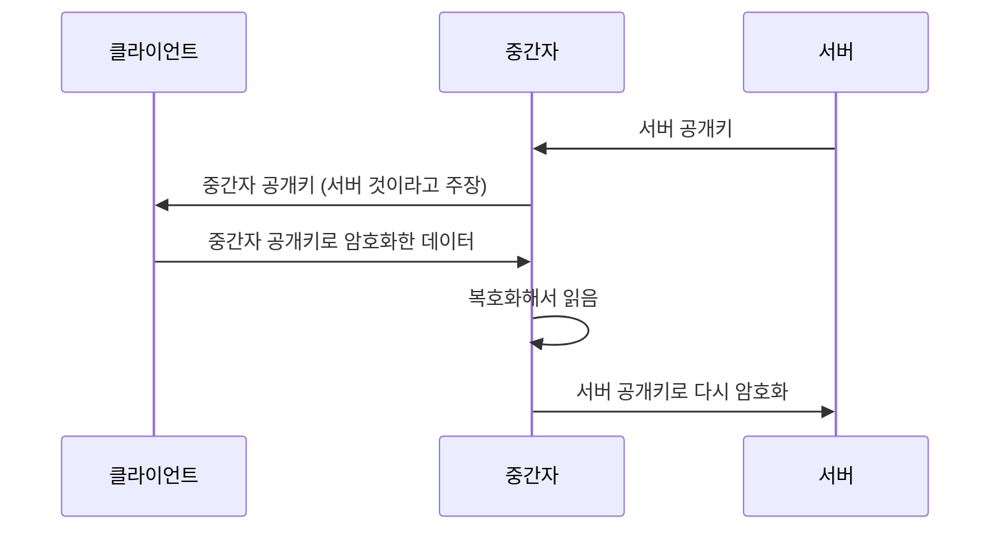
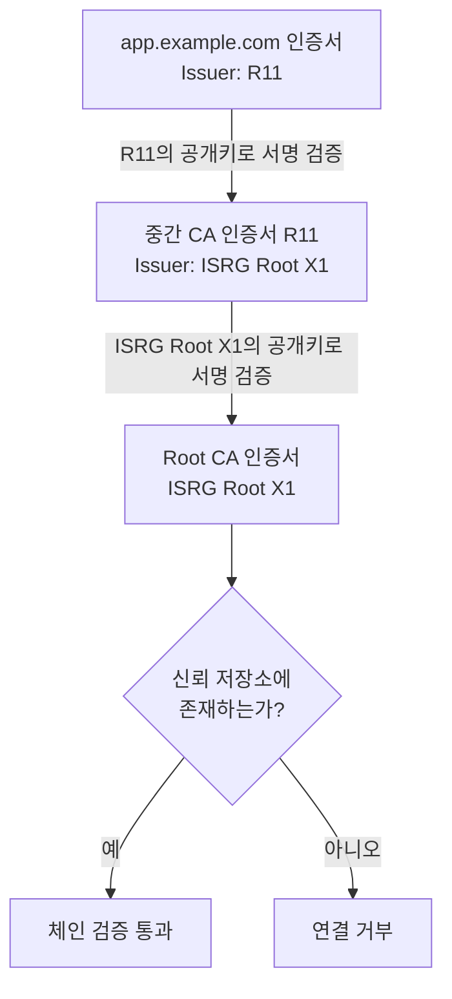

# 2. 인증서와 인증기관

## 2-1. 등장 배경

1장에서 cert-manager는 "인증서를 발급받아 `Secret`에 넣는 컨트롤러"였다. 그렇다면 그 인증서는 무엇이고, 왜 CA라는 제3자가 끼어 있어야 하는가. 이 장은 그 구조를 다룬다.

### 암호화만으로는 부족하다

클라이언트와 서버 사이의 트래픽은 여러 중간 노드를 거친다. 경로 어딘가에서 내용을 읽거나 바꿀 수 있으므로 암호화가 필요하다.

그런데 암호화를 하려면 양쪽이 같은 키를 알아야 한다. 처음 연결하는 상대와 안전하지 않은 경로에서 어떻게 키를 공유할 것인가. 이 문제를 푼 것이 공개키 암호다.

- 서버는 공개키와 개인키 한 쌍을 가진다
- 공개키는 누구에게나 알려도 되고, 공개키로 암호화한 것은 개인키로만 풀 수 있다
- 클라이언트는 서버의 공개키를 받아 그것으로 통신에 쓸 키를 안전하게 전달한다

여기까지는 도청 문제가 해결된다. 하지만 하나가 남는다.

### 남은 문제: 받은 공개키가 누구의 것인가

클라이언트는 서버로부터 공개키를 받는다. 그런데 그 공개키가 정말 그 서버의 것인지 확인할 방법이 없다.

경로 중간에 있는 누군가가 서버의 공개키를 가로채고 자기 공개키를 대신 내려보내면, 클라이언트는 그 사실을 알 수 없다. 클라이언트는 중간자의 공개키로 암호화하고, 중간자는 그것을 풀어 읽은 뒤 다시 서버의 공개키로 암호화해서 전달한다. 양쪽 모두 정상적으로 통신하고 있다고 믿는다.



암호화는 정상적으로 동작했지만 통신 상대가 달랐다. 즉 공개키 암호는 기밀성을 제공하지만 **상대의 신원**은 보장하지 않는다.

### 제3자의 보증

해결책은 신뢰할 수 있는 제3자가 "이 공개키는 이 도메인의 것"이라고 보증해 주는 것이다. 그 보증서가 **인증서**이고, 보증하는 주체가 **CA(Certificate Authority, 인증기관)** 다.

- CA는 도메인 소유권을 확인한 뒤, 공개키와 도메인을 묶은 문서에 자신의 개인키로 서명한다
- 클라이언트는 CA의 공개키로 그 서명을 검증한다. 서명이 유효하면 "CA가 보증한 내용"임이 확인된다
- 중간자가 공개키를 바꿔치기해도 그 공개키에 대한 CA의 서명을 만들어낼 수 없다

1장에서 본 도메인 소유권 검증(HTTP-01, DNS-01)이 바로 CA가 서명하기 전에 수행하는 확인 절차다.

### 신뢰의 출발점

여기서 문제가 한 단계 옮겨간다. CA의 서명을 검증하려면 CA의 공개키가 필요한데, 그 공개키가 진짜 CA의 것인지는 또 어떻게 아는가.

이 연쇄를 끊는 방법은 하나뿐이다. **신뢰할 대상을 미리 정해서 클라이언트에 심어 두는 것**이다. OS와 브라우저는 신뢰하는 CA들의 인증서를 신뢰 저장소(trust store)에 담아 배포한다. 이것이 Root CA이고, 검증의 출발점이다.

Root CA 인증서는 자기 자신이 서명한다(self-signed). 검증할 상위가 없기 때문이다. Root를 신뢰하는 근거는 암호학적 검증이 아니라 "이미 갖고 있다"는 사실이다. 어떤 CA를 신뢰 저장소에 넣을지는 브라우저·OS 벤더의 루트 프로그램이 심사해서 결정한다.

### Root가 직접 서명하지 않는 이유

Root CA의 개인키로 모든 서버 인증서를 직접 서명하면 구조는 단순해진다. 하지만 그렇게 하지 않는다.

- Root 개인키가 유출되면 그 Root를 신뢰하는 모든 인증서가 한꺼번에 무너진다. 신뢰 저장소는 OS·브라우저 업데이트로만 갱신되므로 회수에 수년이 걸린다
- 그래서 Root 개인키는 네트워크에 연결되지 않은 장비에 격리해 두고, 평소에는 쓰지 않는다

대신 Root는 **중간 CA**에게 서명 권한을 위임한다. 실제 서버 인증서 발급은 중간 CA가 담당하고, 중간 CA의 키가 침해되면 해당 중간 CA만 무효화하고 새로 발급하면 된다. Root는 유지된다.

그 결과 인증서는 한 장이 아니라 사슬 형태가 된다.

```
app.example.com 인증서  →  중간 CA 인증서  →  Root CA 인증서
      (서버)                  (온라인)          (오프라인, 신뢰 저장소)
```

이 사슬을 어떻게 따라 올라가며 검증하는지는 2-3에서 다룬다.

## 2-2. 인증서에 담긴 것

인증서는 결국 "이 공개키는 이 도메인의 것"이라는 문장에 CA가 서명한 문서다. 그 문장을 구성하는 데 필요한 항목이 X.509 형식으로 정해져 있다.

전부 볼 필요는 없고, 검증에 직접 쓰이거나 운영 중에 문제가 되는 것 위주로 본다.

| 항목 | 내용 | 왜 중요한가 |
|---|---|---|
| Subject / SAN | 이 인증서가 대표하는 이름 | 접속한 호스트명과 대조된다 |
| Issuer | 이 인증서를 서명한 CA | 체인의 다음 단계를 찾는 기준 |
| Validity | 유효 시작·종료 시각 | 만료되면 연결이 거부된다 |
| Public Key | 서버의 공개키 | 인증서가 보증하는 실체 |
| Basic Constraints | CA 여부와 체인 깊이 제한 | 서버 인증서가 다른 인증서를 서명하지 못하게 막는다 |
| Key Usage / EKU | 이 키로 할 수 있는 일 | 용도가 맞지 않으면 거부된다 |
| Signature | 발급자의 서명 | 위조·변조 여부를 확인한다 |

### Subject와 SAN

Subject는 인증서의 주체를 나타내는 필드이고, 그 안의 CN(Common Name)에 도메인을 적는 것이 원래 방식이었다. 하지만 CN은 하나의 값만 담을 수 있어 여러 도메인을 처리할 수 없었고, 그래서 확장 필드인 SAN이 도입됐다.

지금은 CN을 보지 않는다. Chrome은 2017년, 대부분의 클라이언트도 그 무렵 CN 기반 호스트명 대조를 제거했다. **도메인은 SAN에만 있으면 되고, SAN에 없으면 CN에 적혀 있어도 실패한다.**

- 1장의 `Certificate.spec.dnsNames`가 이 SAN이 된다
- 여러 도메인을 한 인증서로 처리하려면 SAN에 나열한다
- 도메인 외에 IP 주소나 이메일도 SAN에 들어갈 수 있다

### Issuer

이 인증서를 서명한 CA의 이름이다. 검증하는 쪽은 이 값을 보고 다음 단계로 올라갈 인증서를 찾는다. 서버 인증서의 Issuer는 중간 CA의 Subject와 같고, 중간 CA의 Issuer는 Root CA의 Subject와 같다. 이 연결이 체인이다.

이름만으로 찾으면 동명이인 문제가 생기므로, 실제로는 확장 필드인 AKI(Authority Key Identifier)와 SKI(Subject Key Identifier)로 키 단위 매칭을 한다.

### Validity

시작 시각과 종료 시각이 절대 시간으로 박혀 있다. 검증하는 쪽은 자신의 현재 시각과 비교하므로, **클라이언트의 시계가 틀리면 유효한 인증서도 거부된다.** 시간 동기화가 안 된 기기나 컨테이너에서 인증서 오류가 나는 경우가 여기에 해당한다.

1장에서 본 `duration`과 `renewBefore`가 이 구간을 다룬다.

### Basic Constraints

`CA:TRUE`이면 이 인증서의 키로 다른 인증서를 서명할 수 있다. Root CA와 중간 CA는 `TRUE`, 서버 인증서는 `FALSE`다.

이 필드가 없으면 서버 인증서를 하나 발급받은 사람이 그 키로 다른 도메인의 인증서를 마음대로 만들 수 있다. 실제로 초기 브라우저들이 이 필드를 검사하지 않아 발생한 취약점이 있었다. `pathlen`으로 아래에 몇 단계까지 CA를 둘 수 있는지도 제한한다.

### Key Usage와 EKU

키의 용도를 제한한다. Key Usage는 서명, 키 암호화 같은 암호학적 연산 단위이고, EKU(Extended Key Usage)는 목적 단위다.

- `serverAuth`: 서버 인증용. TLS 서버 인증서에 필요
- `clientAuth`: 클라이언트 인증용. mTLS의 클라이언트 인증서에 필요

용도가 맞지 않으면 인증서가 유효해도 거부된다. mTLS를 구성할 때 서버용 인증서를 클라이언트에 그대로 쓰면 여기서 걸린다. 1장의 `Certificate.spec.usages`가 이 값을 지정한다.

### 예시

Let's Encrypt가 발급한 서버 인증서를 열어본 결과다.

```console
$ openssl x509 -in tls.crt -noout -text
Certificate:
    Data:
        Version: 3 (0x2)
        Serial Number: 04:9f:...:c1
        Signature Algorithm: sha256WithRSAEncryption
        Issuer: C=US, O=Let's Encrypt, CN=R11          # ← 이 인증서를 서명한 중간 CA
        Validity
            Not Before: Jul 15 09:21:03 2026 GMT       # ← 90일 수명
            Not After : Oct 13 09:21:02 2026 GMT
        Subject: CN=app.example.com                    # ← 참고용. 검증에는 쓰이지 않는다
        Subject Public Key Info:
            Public Key Algorithm: rsaEncryption
                Public-Key: (2048 bit)
        X509v3 extensions:
            X509v3 Key Usage: critical
                Digital Signature
            X509v3 Extended Key Usage:
                TLS Web Server Authentication          # ← serverAuth
            X509v3 Basic Constraints: critical
                CA:FALSE                               # ← 다른 인증서를 서명할 수 없다
            X509v3 Subject Key Identifier:
                3A:7B:...:E2
            X509v3 Authority Key Identifier:
                C5:CF:...:9A                           # ← 중간 CA의 SKI와 일치한다
            X509v3 Subject Alternative Name:
                DNS:app.example.com, DNS:www.example.com   # ← 실제 검증 대상
            Authority Information Access:
                CA Issuers - URI:http://r11.i.lencr.org/   # ← 중간 CA를 내려받을 수 있는 위치
    Signature Algorithm: sha256WithRSAEncryption
        62:1a:...:8f                                   # ← 중간 CA의 개인키로 만든 서명
```

같은 명령으로 중간 CA 인증서를 열면 구조는 같고 값이 다르다.

```console
        Issuer: C=US, O=Internet Security Research Group, CN=ISRG Root X1   # ← Root가 서명
        Subject: C=US, O=Let's Encrypt, CN=R11                              # ← 서버 인증서의 Issuer와 일치
        X509v3 Basic Constraints: critical
            CA:TRUE, pathlen:0                                              # ← 서명 권한 있음, 아래에 CA를 더 둘 수 없음
        X509v3 Subject Key Identifier:
            C5:CF:...:9A                                                    # ← 서버 인증서의 AKI와 일치
```

Root CA 인증서는 Issuer와 Subject가 같다. 자기 자신이 서명했기 때문이다.

```console
        Issuer:  C=US, O=Internet Security Research Group, CN=ISRG Root X1
        Subject: C=US, O=Internet Security Research Group, CN=ISRG Root X1
        X509v3 Basic Constraints: critical
            CA:TRUE
```

세 인증서에서 Issuer와 Subject, AKI와 SKI가 서로 맞물리는 것이 체인이다.

## 2-3. 신뢰 체인

이제 클라이언트가 `app.example.com`에 접속했을 때 그 인증서를 어떻게 신뢰하게 되는지 본다.

### 서명과 검증

체인 검증의 각 단계는 결국 서명 하나를 확인하는 일이다.

- **서명**: CA가 인증서 본문 전체의 해시를 구하고, 그 해시를 자신의 **개인키**로 처리한 값을 인증서 끝에 붙인다
- **검증**: 클라이언트가 같은 방식으로 본문 해시를 다시 구하고, 붙어 있는 서명을 CA의 **공개키**로 풀어 나온 값과 비교한다

두 값이 같으면 두 가지가 동시에 확인된다. 인증서 본문이 변조되지 않았다는 것과, 그 서명을 만든 주체가 해당 개인키를 갖고 있었다는 것이다. CA의 개인키가 없으면 서명을 만들 수 없으므로, 공격자는 자기 공개키를 담은 인증서를 위조할 수 없다.

여기서 필요한 것은 **상위 CA의 공개키**다. 그 공개키는 상위 CA의 인증서 안에 들어 있다. 그래서 검증은 한 단계 위 인증서를 요구하고, 이 과정이 반복되면서 체인이 된다.

### 검증 순서



1. 서버 인증서의 Issuer를 보고 중간 CA 인증서를 찾는다
2. 중간 CA의 공개키로 서버 인증서의 서명을 검증한다
3. 중간 CA 인증서의 Issuer를 보고 Root CA 인증서를 찾는다
4. Root CA의 공개키로 중간 CA 인증서의 서명을 검증한다
5. Root CA 인증서가 신뢰 저장소에 있는지 확인한다

마지막 단계가 핵심이다. **Root는 서명을 검증하는 대상이 아니다.** Root는 self-signed이므로 자기 서명을 자기 공개키로 검증하는 것은 아무것도 증명하지 못한다. Root에 대해 확인하는 것은 "이미 내 신뢰 저장소에 들어 있는가" 하나뿐이다.

2-1에서 본 "신뢰의 출발점"이 여기서 실제로 쓰인다. 체인 검증은 신뢰 저장소에 도달하는 순간 끝난다.

### 서버가 보내야 하는 것

검증에 필요한 인증서는 서버 인증서, 중간 CA 인증서, Root CA 인증서 세 장이다. 이 중 서버가 전송하는 것은 앞의 두 장이다.

| 인증서 | 전송 여부 | 이유 |
|---|---|---|
| 서버 인증서 | 필수 | 검증 대상 |
| 중간 CA 인증서 | 필수 | 클라이언트가 갖고 있지 않다 |
| Root CA 인증서 | 생략 | 클라이언트의 신뢰 저장소에 이미 있다 |

1장에서 본 `Secret`의 `tls.crt`에 서버 인증서와 중간 CA가 함께 들어 있는 이유가 이것이다.

### 언제 전달되는가

서버 인증서와 **동시에, 같은 메시지 안에서** 전달된다. 검증이 끝난 뒤 추가로 받아오는 것이 아니다. TLS의 `Certificate` 메시지는 인증서 하나가 아니라 인증서 목록이기 때문이다.

```
Certificate
 ├─ [0] app.example.com 인증서   ← leaf가 항상 첫 번째
 └─ [1] 중간 CA 인증서           ← 바로 앞 인증서를 서명한 CA 순서로
```

따라서 체인 때문에 왕복이 늘지는 않는다. 클라이언트는 목록을 한 번에 받은 뒤 **로컬에서** 체인을 검증한다. `tls.crt` 파일 하나에 leaf와 중간 CA를 이어붙여 두는 이유도 그 파일 내용이 그대로 이 목록이 되기 때문이다.

예외는 뒤에서 다룰 AIA fetching이다. 서버가 중간 CA를 빼먹었을 때 클라이언트가 별도로 가져오는 경우인데, 이때만 추가 왕복이 생긴다.

중간 CA를 빠뜨리면 특정 조건에서만 실패하는 상태가 된다. 브라우저 중에는 이전에 다른 사이트에서 받은 중간 CA를 캐시해 두었거나, 인증서의 AIA 필드에 적힌 주소에서 중간 CA를 직접 내려받는 구현이 있다. 이런 클라이언트에서는 성공한다.

> **AIA (Authority Information Access)**: 이 인증서와 관련된 CA 정보를 어디서 얻을 수 있는지를 담은 **확장 필드 하나**다. 값은 `{ 접근 방법, 접근 위치 }` 쌍의 목록이고, `CA Issuers`와 `OCSP`는 별도의 필드가 아니라 그 안에 들어가는 항목의 종류다.
>
> ```
> X509v3 Authority Information Access:          ← 확장 필드 하나
>     OCSP - URI:http://r11.o.lencr.org         ← 항목 1
>     CA Issuers - URI:http://r11.i.lencr.org/  ← 항목 2
> ```
>
> 즉 OCSP 응답 서버 주소는 인증서 안에 있다. 클라이언트가 어디에 물어봐야 할지를 발급 시점에 CA가 적어 넣는다. 인증서마다 자기 AIA를 가지므로 중간 CA 인증서에도 자체 AIA가 들어 있다. 반면 CRL 주소는 AIA가 아니라 별도 확장 필드(`CRL Distribution Points`)다.
>
> 다만 이 주소를 따라가는 것은 의무가 아니다. 브라우저는 대체로 따라가지만(AIA fetching), 프로그래밍 언어의 기본 TLS 클라이언트는 대부분 따라가지 않는다.

반면 캐시가 없는 브라우저, AIA를 따라가지 않는 구현, 그리고 대부분의 프로그래밍 언어 HTTP 클라이언트에서는 실패한다. "브라우저에서는 되는데 서버 간 호출에서만 실패한다"는 증상이 나오면 중간 CA 누락을 먼저 본다.

언어 라이브러리가 AIA를 따라가지 않는 이유는 중간 CA 전송이 표준상 서버의 의무이기 때문이다. 클라이언트가 이를 보완하려면 다음을 감수해야 한다.

- 핸드셰이크 도중에 별도의 HTTP 요청을 보내야 한다. 지연이 생기고, 그 요청이 실패하면 연결도 실패한다
- 인증서에 적힌 임의의 URL로 요청을 보내게 된다. 접속 대상 서버가 제시한 값을 보고 클라이언트가 그 주소에 접속하는 구조이므로, 내부망에서 동작하는 클라이언트에는 SSRF에 가까운 위험이 된다
- 네트워크 상태에 따라 같은 인증서의 검증 결과가 달라진다

브라우저는 잘못 설정된 사이트가 많다는 현실 때문에 예외적으로 보완하는 쪽을 택했다.

한 가지 예외가 있다. OS의 TLS 스택을 쓰는 클라이언트는 AIA를 따라간다. Windows의 Schannel과 macOS의 Security 프레임워크가 그렇다. 그래서 Windows에서 동작하던 코드가 Linux 컨테이너에서만 실패하는 경우가 생긴다. Go, Java, Python, Node.js처럼 자체 검증 로직을 쓰는 쪽은 플랫폼과 무관하게 실패한다.

### 서명 외에 확인하는 것

체인의 서명이 모두 유효해도 아래 항목 중 하나라도 어긋나면 연결은 거부된다.

| 항목 | 확인 내용 | 어긋날 때 |
|---|---|---|
| 유효기간 | 현재 시각이 Validity 구간 안에 있는가 | 만료 또는 클라이언트 시계 오류 |
| 호스트명 | 접속한 이름이 SAN에 있는가 | 도메인 불일치 |
| 용도 | EKU에 `serverAuth`가 있는가 | 용도가 다른 인증서 |
| CA 여부 | 체인 중간 인증서가 `CA:TRUE`인가 | 서버 인증서가 CA 자리에 있음 |
| 폐기 | 발급 후 무효화되지 않았는가 | 폐기된 인증서 |

이 중 호스트명 대조는 인증서만으로 판단할 수 없다는 점을 짚어둘 만하다. 클라이언트가 어떤 이름으로 접속했는지를 알아야 하므로, 인증서 검증은 항상 "무엇에 접속했는가"와 함께 이뤄진다. IP로 직접 접속하면 SAN에 그 IP가 없는 한 실패한다.

### 폐기 확인

**왜 필요한가**

인증서에는 유효기간이 박혀 있고, 한번 발급되면 그 내용을 바꿀 수 없다. 그런데 서버의 개인키가 유출되면 문제가 생긴다. 공격자는 그 키와 인증서를 그대로 들고 다른 서버에서 정상적인 HTTPS 서비스를 열 수 있다. 인증서 자체는 CA가 서명한 진짜이므로 클라이언트는 아무 이상을 발견하지 못한다.

이런 인증서를 만료 전에 무효화하는 것이 폐기(revocation)다. 문제는 인증서를 회수할 방법이 없다는 점이다. 이미 배포된 파일이므로 CA가 "이건 이제 무효"라고 별도로 알리는 수밖에 없다. 그래서 클라이언트는 체인 검증과 별개로 **CA에게 이 인증서가 아직 유효한지 물어보는** 단계가 필요해진다.

**두 가지 방식**

- **CRL(Certificate Revocation List)**: CA가 폐기한 인증서의 일련번호 목록을 파일로 공개한다. 클라이언트는 이 목록을 내려받아 대조한다. 문제는 크기다. CA 하나가 발급한 인증서 전체에 대한 목록이라 수 MB까지 커지고, 접속할 때마다 이를 받을 수는 없어 캐시하게 된다. 그만큼 최신 상태가 아니다
- **OCSP(Online Certificate Status Protocol)**: 목록 대신 인증서 하나의 상태만 CA 서버에 질의한다. 응답은 작고 최신이지만, 접속할 때마다 CA에 요청이 나가므로 연결이 느려진다. 또 사용자가 어떤 사이트에 접속하는지가 CA에게 노출된다

**OCSP stapling**

클라이언트가 매번 CA에 묻는 구조를 뒤집은 방식이다. 서버가 미리 자기 인증서에 대한 OCSP 응답을 받아 두었다가, TLS 핸드셰이크 때 인증서와 함께 클라이언트에 건네준다. 응답에는 CA의 서명이 붙어 있어 서버가 위조할 수 없다.

클라이언트는 CA에 접속할 필요가 없어지므로 지연과 프라이버시 문제가 함께 해결된다.

**남는 문제**

여기까지 왔는데도 폐기는 제대로 동작하지 않는다. 이유는 **폐기 정보를 확인하지 못했을 때 어떻게 할 것인가**에 있다.

CA의 OCSP 서버가 응답하지 않는 상황을 생각해 보자. 클라이언트가 선택할 수 있는 것은 두 가지다.

- 연결을 차단한다 → CA 서버 장애 한 번이 그 CA로 발급된 모든 사이트의 장애가 된다
- 그냥 통과시킨다 → 폐기 확인이 사실상 없는 것과 같아진다

브라우저들은 두 번째를 택했다. 첫 번째는 위험이 너무 크기 때문이다. 그런데 이 선택은 공격자에게 우회로를 준다. 개인키를 훔친 공격자가 중간에서 OCSP 요청만 막아버리면, 클라이언트는 확인에 실패하고 그대로 연결을 진행한다. 폐기된 인증서가 계속 통한다.

**그래서 수명 단축으로**

확인 절차를 강제할 수 없다면 남은 방법은 인증서가 유효한 기간 자체를 줄이는 것이다. 90일짜리 인증서라면 키가 유출돼도 피해 기간이 최대 90일이고, 47일이면 그만큼 더 짧아진다.

1장에서 본 SC-081v3도 근거 중 하나로 "CRL과 OCSP 같은 인증서 상태 서비스는 현재 인터넷 규모에서 의존하는 측을 충분히 보호하지 못한다"는 점을 들었다.

Let's Encrypt는 2025년 8월 6일 OCSP 응답 서버를 꺼고 폐기 정보를 CRL로 일원화했다. 다만 이쪽의 공식 이유는 "동작하지 않아서"가 아니라 **프라이버시와 운영 단순화**다. OCSP는 응답 서버가 방문 기록을 알게 되는 구조이기 때문이다.

- [Replacing OCSP with CRLs — Let's Encrypt (2024-07)](https://letsencrypt.org/2024/07/23/replacing-ocsp-with-crls/)
- [Ending OCSP Support in 2025 — Let's Encrypt (2024-12)](https://letsencrypt.org/2024/12/05/ending-ocsp/)

---

## 참고자료

**표준**

- [RFC 5280: Internet X.509 Public Key Infrastructure Certificate and CRL Profile](https://datatracker.ietf.org/doc/html/rfc5280) — 인증서 형식과 검증 알고리즘
- [RFC 5280 §4.2.1.6: Subject Alternative Name](https://datatracker.ietf.org/doc/html/rfc5280#section-4.2.1.6)
- [RFC 5280 §4.2.1.9: Basic Constraints](https://datatracker.ietf.org/doc/html/rfc5280#section-4.2.1.9)
- [RFC 5280 §4.2.2.1: Authority Information Access](https://datatracker.ietf.org/doc/html/rfc5280#section-4.2.2.1)
- [RFC 6960: Online Certificate Status Protocol (OCSP)](https://datatracker.ietf.org/doc/html/rfc6960)

**체인과 신뢰 저장소**

- [Chain of Trust — Let's Encrypt](https://letsencrypt.org/certificates/) — ISRG Root X1, 중간 CA 구성
- [Certificate Compatibility — Let's Encrypt](https://letsencrypt.org/docs/certificate-compatibility/) — 클라이언트별 신뢰 저장소 현황
- [New Life for CRLs — Let's Encrypt](https://letsencrypt.org/2022/09/07/new-life-for-crls/)

**구현체 동작**

- [TLS Terminology — cert-manager](https://cert-manager.io/docs/reference/tls-terminology/)
- [Certificate resource — cert-manager](https://cert-manager.io/docs/usage/certificate/) — `tls.crt`에 Root를 넣지 않는 이유


