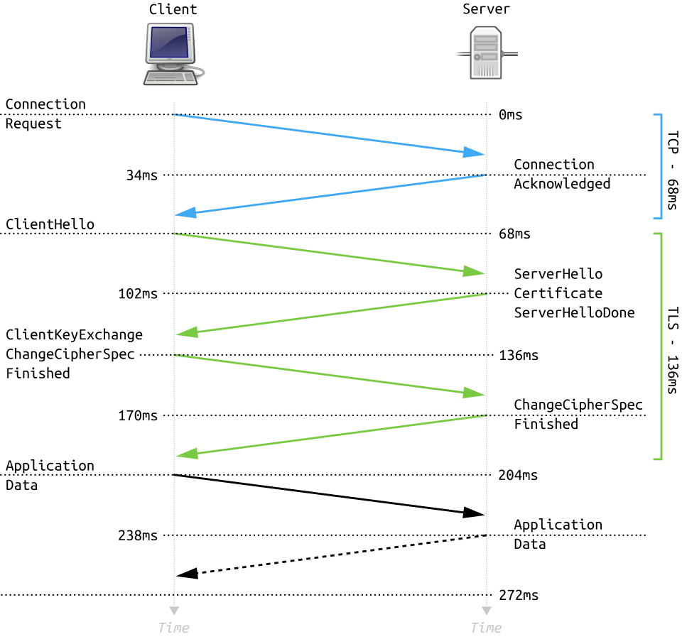
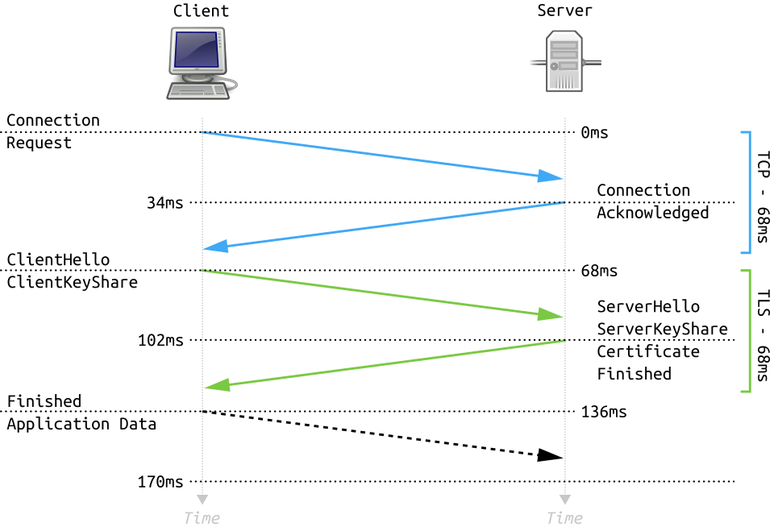
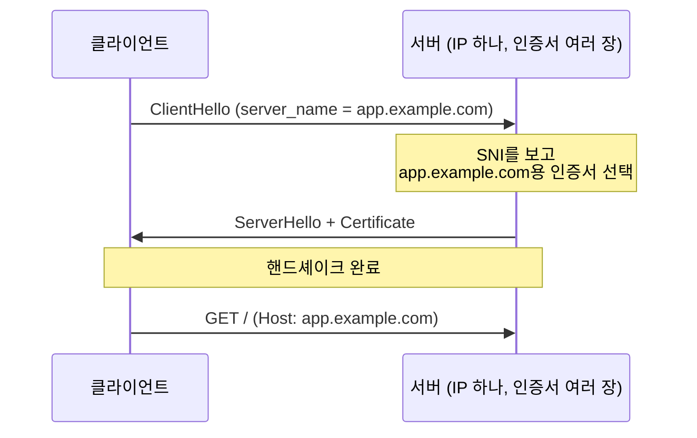
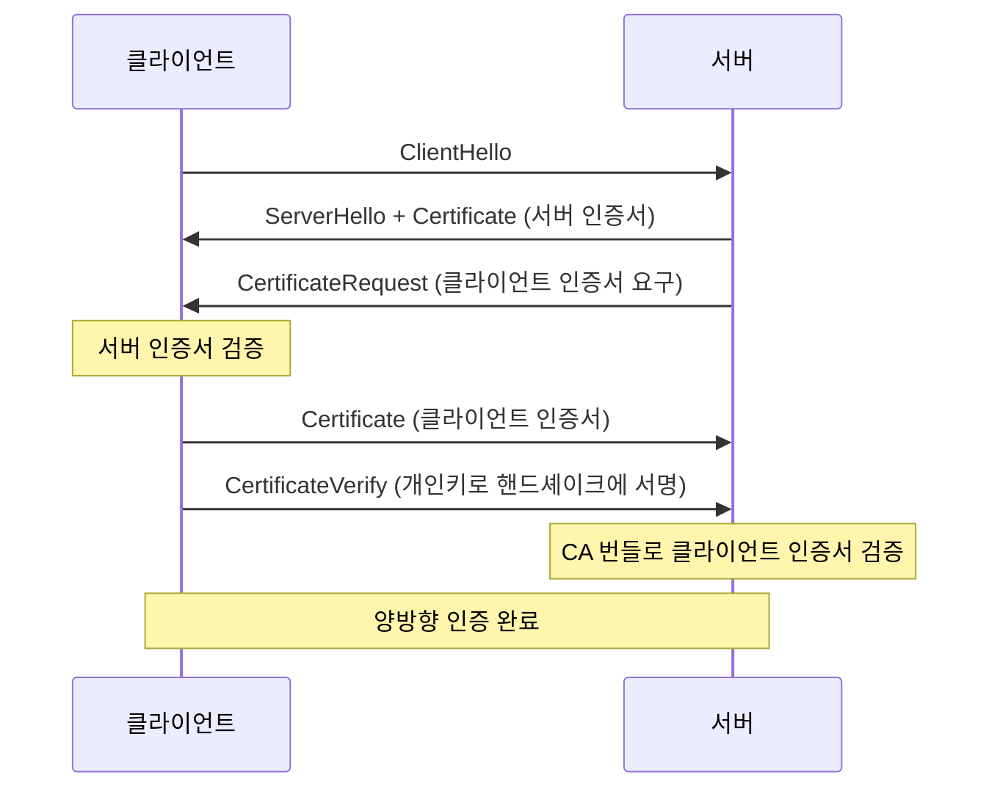
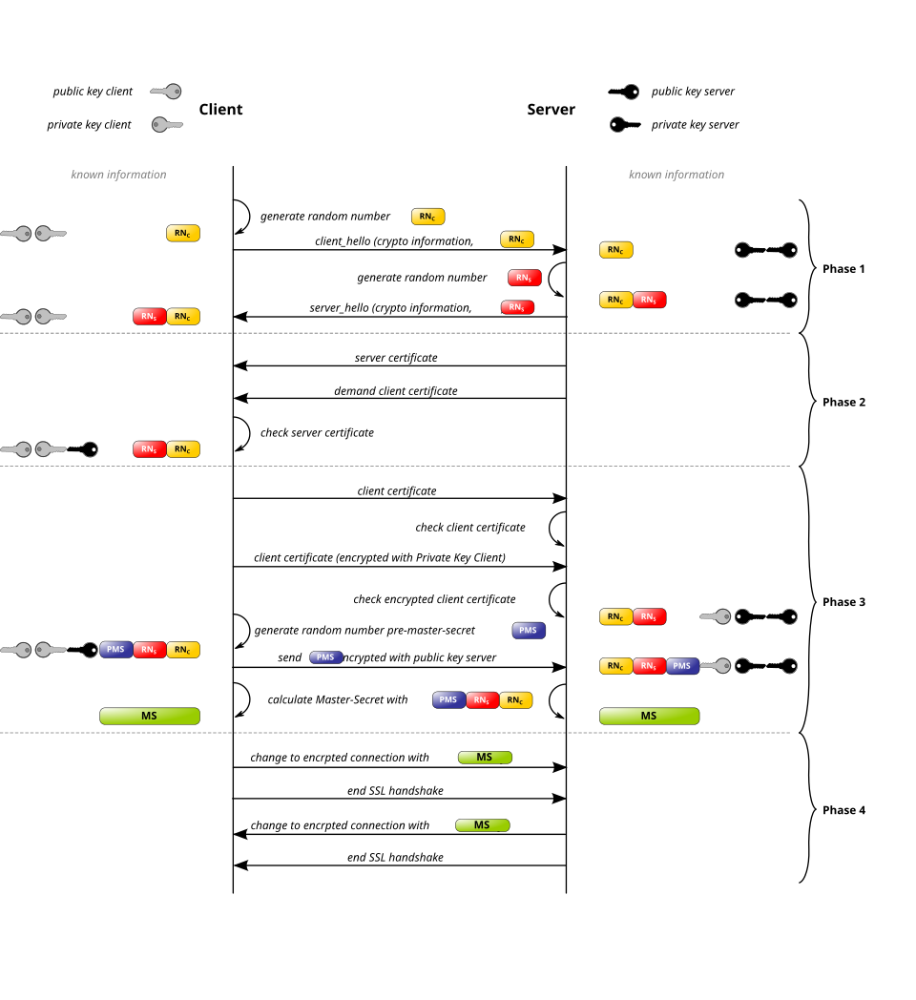
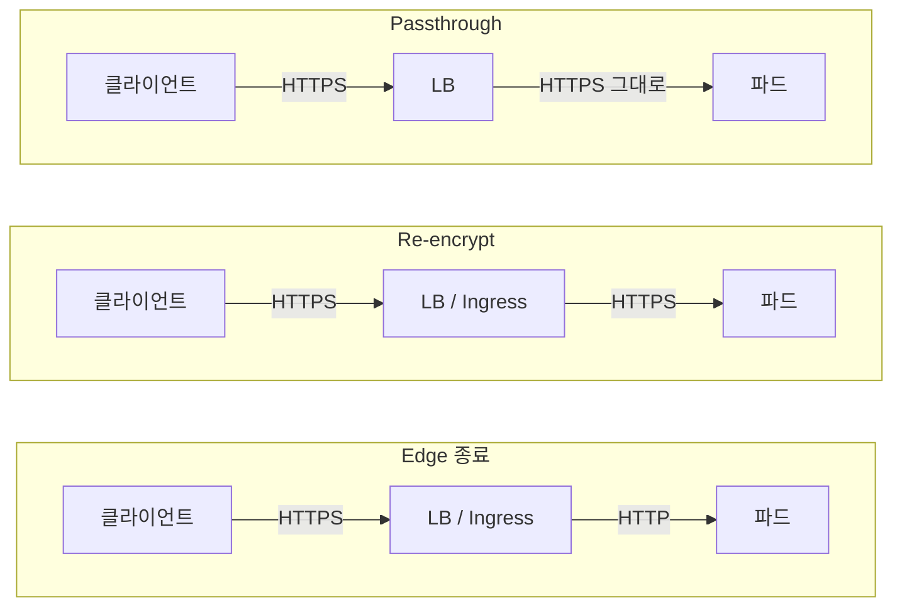

# 3. TLS와 HTTP

## 3-1. TLS 1.2 → 1.3

### TLS란 무엇인가

TCP는 데이터를 그대로 실어 나른다. 경로 위의 누구나 내용을 읽고 바꿀 수 있다. TLS(Transport Layer Security)는 TCP 위에 얹혀서 그 문제를 해결하는 프로토콜이다.

TLS가 제공하는 것은 세 가지다.

| 보장 | 내용 | 수단 |
|---|---|---|
| 기밀성 | 제3자가 내용을 읽을 수 없다 | 대칭키 암호화 |
| 무결성 | 내용이 변조되면 감지된다 | 인증 태그 |
| 인증 | 상대가 주장하는 그 서버가 맞다 | 2장의 인증서 |

무결성은 데이터에 검증용 태그를 붙여서 보장한다. 받는 쪽이 같은 방식으로 태그를 다시 계산해 비교하고, 다르면 변조된 것으로 보고 연결을 끊는다. 이 태그를 암호화와 별도로 계산하는 방식을 MAC, 암호화와 한번에 처리하는 방식을 AEAD라고 한다. TLS 1.3은 AEAD만 쓴다.

세 번째가 2장에서 다룬 인증서다. 인증서는 TLS 안에서 쓰이는 재료이고, 그것을 실제로 주고받는 절차가 TLS 핸드셰이크다.

이름의 역사가 조금 얽혀 있다. 원래 Netscape가 만든 SSL(Secure Sockets Layer)이 IETF로 넘어가면서 TLS로 이름이 바뀌었다. SSL 3.0의 다음 버전이 TLS 1.0이다. 지금도 "SSL 인증서"라는 표현이 쓰이지만 프로토콜은 모두 TLS다.

| 버전 | 발표 | 상태 |
|---|---|---|
| SSL 2.0 / 3.0 | 1995 / 1996 | 폐기 |
| TLS 1.0 / 1.1 | 1999 / 2006 | 2020년 주요 브라우저에서 지원 종료 |
| TLS 1.2 | 2008 | 사용 중 |
| TLS 1.3 | 2018 (RFC 8446) | 사용 중 |

### 동작의 큰 그림

TLS는 두 단계로 나뉜다.

- **핸드셰이크**: 서로를 확인하고 이번 연결에 쓸 대칭키를 합의한다
- **레코드**: 합의한 대칭키로 실제 데이터를 암호화해 주고받는다

여기서 중요한 것은 공개키 암호가 실제 데이터 암호화에 쓰이지 않는다는 점이다. 공개키 연산은 대칭키 연산보다 훨씬 느리다. 그래서 **공개키는 대칭키를 안전하게 합의하는 데만 쓰고, 데이터는 대칭키로 암호화한다.** 2-1에서 본 "공개키로 통신에 쓸 키를 전달한다"가 이 구조다.

**얼마나 느린가**

`openssl speed`로 측정한 값이다. 1 KB를 처리하는 데 걸리는 시간으로 환산했다.

| 연산 | 측정값 | 1회(또는 1 KB) 소요 시간 | AES 대비 |
|---|---|---|---|
| AES-128-GCM 암호화 | 134.7 MB/s | **7.6 µs** (1 KB 기준) | 1× |
| RSA-2048 검증 (공개키) | 17,413 회/s | 57 µs | 7배 |
| ECDSA P-256 서명 (개인키) | 1,226 회/s | 816 µs | **107배** |
| RSA-2048 서명 (개인키) | 490 회/s | 2,040 µs | **268배** |

```console
$ openssl speed -seconds 1 rsa2048
$ openssl speed -seconds 1 ecdsap256
$ openssl speed -seconds 1 -evp aes-128-gcm
```

개인키 연산 한 번이 1 KB를 대칭키로 암호화하는 것보다 100~270배 비싸다. 절대값은 하드웨어와 빌드에 따라 달라지지만 자릿수 차이는 유지되고, AES 하드웨어 가속(AES-NI 등)이 적용되면 격차는 더 벌어진다.

그래서 TLS는 공개키 연산을 **연결당 몇 번**으로 제한하고, 그 뒤의 모든 데이터는 대칭키로 처리한다. 3-1에서 본 세션 재개(0-RTT)나 연결 재사용이 성능에 크게 기여하는 이유도 이 표에 있다.

핸드셰이크에서 결정되는 것은 네 가지다.

- 어떤 알고리즘을 쓸 것인가 (cipher suite)
- 대칭키를 어떻게 합의할 것인가 (키 교환)
- 서버가 진짜인가 (인증서 검증)
- 최종 대칭키는 무엇인가

### TLS 1.2의 핸드셰이크



<sub>출처: [Full TLS 1.2 Handshake — Wikimedia Commons](https://commons.wikimedia.org/wiki/File:Full_TLS_1.2_Handshake.svg)</sub>

RTT 34ms를 가정한 그림이다. TCP 연결에 68ms, TLS 핸드셰이크에 다시 136ms가 들고, 첫 응답을 받기까지 272ms가 걸린다.

> **RTT (Round-Trip Time)**: 패킷이 상대에게 갔다가 돌아오는 데 걸리는 시간. 핸드셰이크의 비용을 측정할 때 초 단위 시간이 아니라 "왕복 몇 번"으로 세는 이유는, 실제 소요 시간이 거리와 회선 상태에 따라 달라지기 때문이다. 왕복 횟수는 프로토콜이 결정한다.

동작을 풀어 보면 이렇다.

1. 클라이언트가 자신이 지원하는 알고리즘 조합을 **목록으로** 보낸다 (`ClientHello`)
2. 서버가 그중 하나를 골라 알려주고, 인증서와 키 교환 파라미터를 보낸다 (`ServerHello`, `Certificate`)
3. 클라이언트가 인증서를 검증하고(2장), 자기 몫의 키 교환 파라미터를 보낸다 (`ClientKeyExchange`)
4. 양쪽이 같은 대칭키를 계산하고, `Finished`로 서로 검증한다

암호화된 데이터를 보내기까지 **왕복 2회**가 필요하다. 그림에서 초록색 구간이 이에 해당한다.

**cipher suite**

TLS 연결 하나를 만들려면 서로 다른 종류의 알고리즘이 여러 개 필요하다. 대칭키를 합의할 방법, 서버를 인증할 방법, 데이터를 암호화할 방법, 무결성을 확인할 방법이 각각 필요하다.

이를 하나씩 따로 협상하면 서로 맞지 않는 조합이 나올 수 있다. 그래서 TLS는 **검증된 조합을 미리 묶어 이름을 붙여 두고, 핸드셰이크에서는 그 이름 중 하나를 고르는** 방식을 쓴다. 이 묶음 하나를 cipher suite라고 한다.

```
TLS_ECDHE_RSA_WITH_AES_128_GCM_SHA256
     └키교환┘ └인증┘    └대칭암호┘  └해시┘
```

| 구성 요소 | 예시의 값 | 역할 |
|---|---|---|
| 키 교환 | ECDHE | 대칭키를 어떻게 합의할 것인가 |
| 인증 | RSA | 서버가 자신을 증명할 때 쓰는 서명 방식 |
| 대칭 암호 | AES_128_GCM | 실제 데이터를 암호화할 방식 |
| 해시 | SHA256 | 무결성 확인과 키 유도에 쓰는 해시 함수 |

클라이언트는 자신이 지원하는 cipher suite 이름을 선호도 순서대로 나열해 보내고, 서버는 그중 자신도 지원하는 것을 골라 답한다. 서버 설정에서 "허용 cipher suite 목록"을 관리한다는 것은 이 후보 목록을 손보는 일이다.

TLS 1.2에는 이 조합이 수십 가지로 정의되어 있었다. 그리고 그중에는 오래된 클라이언트와의 호환을 위해 남겨둔 취약한 조합도 섞여 있었다.

**키 교환 방식**

TLS 1.2는 대칭키를 합의하는 방법을 두 가지 허용했다.

- **RSA 키 전송**: 클라이언트가 대칭키의 재료를 만들어 서버의 공개키로 암호화해서 보낸다. 서버가 개인키로 푼다
- **(EC)DHE**: 양쪽이 각각 임시 키 쌍을 만들어 공개값만 교환하고, 각자 계산으로 같은 값에 도달한다. 대칭키가 네트워크를 지나가지 않는다

두 방식의 차이는 서버 개인키가 유출됐을 때 드러난다. RSA 키 전송은 대칭키 재료가 서버 공개키로 암호화되어 전송되므로, 누군가 트래픽을 저장해 두었다가 나중에 서버 개인키를 손에 넣으면 **과거 통신을 전부 복호화할 수 있다.**

(EC)DHE는 임시 키를 매 연결마다 새로 만들고 버린다. 서버 개인키는 신원 증명(서명)에만 쓰이고 대칭키 계산에는 관여하지 않는다. 그래서 개인키가 유출돼도 과거 트래픽은 안전하다. 이 성질을 **전방향 안전성(PFS, Perfect Forward Secrecy)** 이라고 한다.

### TLS 1.2의 문제

**1. 느리다**

핸드셰이크에 2 RTT가 필요하다. 지연이 큰 모바일 환경에서 체감이 크고, 연결이 많은 웹에서는 누적된다.

**2. 취약한 선택지가 남아 있다**

협상 목록에 안전하지 않은 조합이 포함되어 있었고, 이를 노린 공격이 반복해서 나왔다.

| 공격 | 연도 | 대상 |
|---|---|---|
| BEAST | 2011 | CBC 모드의 IV 처리 |
| CRIME | 2012 | TLS 압축 |
| Lucky13 | 2013 | CBC 패딩 처리 시간 차이 |
| POODLE | 2014 | SSL 3.0으로의 폴백 |
| FREAK / Logjam | 2015 | 수출용 약한 키로의 다운그레이드 |
| Sweet32 | 2016 | 3DES의 짧은 블록 크기 |
| ROBOT | 2017 | RSA 키 전송의 패딩 오라클 |

각각을 개별 패치로 막아 왔지만, 근본 원인은 취약한 선택지가 프로토콜에 남아 있다는 것이었다.

**3. 다운그레이드 공격**

협상 초반은 평문이다. 중간자가 ClientHello의 지원 목록을 조작해 약한 조합만 남기면, 양쪽은 그것이 최선이라고 믿고 약한 암호로 연결한다. FREAK와 Logjam이 이 방식이었다.

**4. 인증서가 평문으로 오간다**

`Certificate` 메시지가 암호화 전에 전송된다. 도청자는 클라이언트가 어떤 사이트에 접속하는지 인증서만 보고 알 수 있다.

### TLS 1.3의 핸드셰이크

TLS 1.3은 위 문제들을 개별 패치가 아니라 프로토콜 재설계로 해결했다.



<sub>출처: [Full TLS 1.3 Handshake — Wikimedia Commons](https://commons.wikimedia.org/wiki/File:Full_TLS_1.3_Handshake.svg)</sub>

앞의 그림과 같은 조건이다. TCP 연결은 동일하게 68ms지만 TLS 핸드셰이크가 136ms에서 68ms로 줄었고, 첫 요청 전송 시점이 204ms에서 136ms로 앞당겨졌다.

서버가 보내는 `Certificate`는 이미 암호화된 상태다. 그림에는 생략되어 있지만 같은 구간에 `EncryptedExtensions`와 `CertificateVerify`도 함께 전송된다.

**1. 1-RTT로 단축**

핵심은 클라이언트가 **묻기 전에 미리 보내는** 것이다. TLS 1.2에서는 서버가 키 교환 방식을 고른 뒤에야 클라이언트가 자기 값을 보낼 수 있었다. TLS 1.3은 클라이언트가 ClientHello에 "아마 이 방식을 쓸 테니 내 값은 이것"이라며 key share를 함께 보낸다.

서버는 ServerHello를 보내는 시점에 이미 양쪽 값을 갖게 되므로 그 자리에서 대칭키를 확정한다. 이후 인증서를 포함한 나머지 메시지는 전부 암호화되어 나간다. 왕복이 한 번 줄었고, 동시에 4번 문제(인증서 평문 노출)도 해결됐다.

추측이 틀리면(서버가 다른 그룹을 원하면) `HelloRetryRequest`로 한 번 더 왕복한다. 즉 최악의 경우가 TLS 1.2의 기본값과 같다.

**무엇으로 암호화하는가**

"인증서가 암호화된다"는 말은 key share 자체를 키로 쓴다는 뜻이 아니다. 순서는 이렇다.

1. `ClientHello`에 클라이언트의 임시 공개값(key share) — 평문
2. `ServerHello`에 서버의 임시 공개값 — 평문
3. 이 시점에 양쪽이 각자 계산해 같은 공유 비밀에 도달한다((EC)DHE)
4. 그 공유 비밀에서 **핸드셰이크 키**를 유도한다
5. `EncryptedExtensions`, `Certificate`, `CertificateVerify`, `Finished`가 이 키로 암호화된다

키는 두 단계로 나뉜다.

| 키 | 생기는 시점 | 보호 대상 |
|---|---|---|
| 핸드셰이크 키 | `ServerHello` 직후 | 인증서 등 나머지 핸드셰이크 메시지 |
| 애플리케이션 키 | `Finished` 이후 | 실제 데이터 |

여기서 순서가 이상하게 느껴질 수 있다. 아직 서버가 인증되지 않았는데 암호화부터 하기 때문이다. 실제로 이 시점의 암호화는 **도청자만 막을 뿐 중간자를 막지 못한다.** 중간자가 자기 key share로 응답하면 그 중간자와의 암호화된 통로가 만들어진다.

그것을 걸러내는 것이 바로 다음에 오는 `Certificate`와 `CertificateVerify`다. 중간자는 그 인증서에 대응하는 개인키가 없어 서명을 만들 수 없고, 검증이 실패해 연결이 끊긴다. 2-1에서 본 중간자 공격 구조가 여기서 차단된다.

즉 **인증서 암호화는 신뢰를 위한 것이 아니라 프라이버시를 위한 것**이다. 신뢰는 그 뒤 서명 검증에서 결정된다.

**2. 선택지 제거**

TLS 1.3은 취약한 것을 모두 삭제했다.

| 제거된 것 | 이유 |
|---|---|
| RSA 키 전송 | PFS 없음, 패딩 오라클 |
| 정적 DH | PFS 없음 |
| CBC 모드, RC4, 3DES | BEAST, Lucky13, Sweet32 |
| SHA-1, MD5 | 충돌 공격 |
| TLS 압축 | CRIME |
| 재협상 | 관련 취약점 다수 |

그 결과 cipher suite가 다섯 개로 줄었고, 구조도 바뀌었다.

```
TLS_AES_128_GCM_SHA256
     └대칭암호┘ └해시┘
```

키 교환과 인증이 cipher suite에서 빠졌다. 키 교환은 (EC)DHE로 고정되어 협상할 필요가 없어졌고, 인증 방식은 별도 확장으로 협상한다. **PFS가 선택이 아니라 프로토콜의 전제가 됐다.**

**3. 다운그레이드 차단**

`CertificateVerify`에서 서버는 핸드셰이크에서 오간 메시지 전체(transcript)에 대해 서명한다. 중간자가 ClientHello를 조작했다면 양쪽이 기억하는 내용이 달라져 서명 검증이 실패한다.

여기에 더해 서버가 TLS 1.3을 지원하면서도 1.2로 협상하게 된 경우, ServerHello의 랜덤값 끝부분에 정해진 표식을 넣는다. 클라이언트는 이 값을 보고 다운그레이드가 강제된 것인지 판단할 수 있다.

**4. 0-RTT (선택)**

이전에 연결한 적 있는 서버라면, 그때 받아둔 값을 이용해 **첫 패킷에 데이터를 실어 보낼 수 있다.** 왕복 없이 요청이 시작된다.

다만 이 데이터는 재전송 공격에 취약하다. 공격자가 그 패킷을 복사해 여러 번 보내면 서버가 같은 요청을 반복 처리할 수 있다. 그래서 조회처럼 반복해도 문제없는 요청에만 쓰도록 되어 있다.

### 실무에서의 차이

| | TLS 1.2 | TLS 1.3 |
|---|---|---|
| 핸드셰이크 | 2 RTT | 1 RTT (재연결 시 0-RTT) |
| cipher suite | 수십 가지 | 5개 |
| PFS | 설정에 따라 다름 | 강제 |
| 인증서 전송 | 평문 | 암호화 |
| 다운그레이드 | 가능했음 | 차단 |

설정 관점에서 보면 TLS 1.3은 **고를 것이 거의 없다.** TLS 1.2에서 cipher suite 목록을 관리하고 약한 조합을 빼는 작업이 필요했다면, 1.3에서는 그 작업 자체가 사라진다.

한 가지 짚어둘 것은, TLS 1.3이 여전히 평문으로 남겨둔 값이 하나 있다는 점이다. 인증서는 암호화됐지만 클라이언트가 어느 호스트에 접속하려는지는 ClientHello에 그대로 드러난다. 그 값이 다음 절에서 다룰 SNI다.

## 3-2. SNI

### 배경: 하나의 IP에 여러 도메인

초기 웹은 도메인 하나가 IP 하나를 가졌다. 그러나 IPv4 주소가 부족해지면서 하나의 IP에 여러 도메인을 올리는 구성이 일반화됐다. 지금의 로드밸런서나 Ingress도 마찬가지다. 진입점 IP는 하나고 그 뒤에 여러 서비스가 있다.

HTTP는 이 문제를 `Host` 헤더로 해결했다. 클라이언트가 요청에 "나는 `app.example.com`을 찾아왔다"를 적어 보내면 서버가 그것을 보고 적절한 응답을 돌려준다.

문제는 HTTPS다. 순서를 보면 이렇다.

1. TCP 연결
2. **TLS 핸드셰이크 — 서버가 인증서를 보내야 한다**
3. HTTP 요청 — `Host` 헤더가 여기 들어 있다

서버는 2번 단계에서 어떤 인증서를 보낼지 결정해야 하는데, 클라이언트가 어느 도메인을 찾는지는 3번에 가서야 알 수 있다. `Host` 헤더는 암호화된 통로 안에 들어 있고, 그 통로를 만들려면 먼저 인증서를 골라야 하기 때문이다.

그래서 과거에는 HTTPS 사이트마다 전용 IP가 필요했다.

### 해결: ClientHello에 호스트명을 싣는다

SNI(Server Name Indication)는 클라이언트가 **핸드셰이크의 첫 메시지에** 접속하려는 호스트명을 넣어 보내는 TLS 확장이다(RFC 6066).



서버는 SNI 값을 보고 가지고 있는 인증서 중 맞는 것을 골라 보낸다. 이것만으로 하나의 IP와 하나의 포트에서 수백 개의 HTTPS 도메인을 서비스할 수 있게 됐다.

### 쿠버네티스에서의 의미

1장에서 인증서가 `Secret` 단위로 따로따로 만들어졌던 것을 떠올려 보자. Ingress의 `spec.tls` 블록마다 `Secret`이 하나씩 생긴다고 했다.

그 `Secret`들을 Ingress Controller가 전부 메모리에 올려두고, **들어오는 연결의 SNI를 보고 그중 하나를 고른다.** 파드 하나, IP 하나로 여러 도메인을 처리하는 구조가 SNI 위에 서 있는 셈이다.

### SNI가 없거나 맞지 않을 때

**SNI를 보내지 않은 경우**

IP로 직접 접속하면 SNI가 비어 있다. 서버는 어떤 인증서를 보낼지 판단할 근거가 없으므로 기본 인증서를 내놓는다. nginx Ingress에서 `Kubernetes Ingress Controller Fake Certificate`라는 인증서가 보이는 상황이 이것이다.

이때 클라이언트는 SAN 불일치로 연결을 거부한다. 인증서가 잘못 발급된 것이 아니라 서버가 다른 인증서를 골랐기 때문이다.

**SNI와 Host 헤더가 다른 경우**

둘은 서로 다른 계층의 값이라 일치할 의무가 없다. `curl --resolve`나 `-H "Host: ..."` 같은 옵션으로 테스트할 때 이 둘이 갈라질 수 있다.

결과는 어긋난다. **인증서는 SNI 기준으로 고르고, 라우팅은 Host 헤더 기준으로 한다.** A 도메인의 인증서로 연결하고 B 도메인의 백엔드로 라우팅되는 상황이 된다. 테스트는 통과했는데 실제 접속은 안 되는 경우가 여기서 나온다.

### SNI는 평문이다

3-1에서 TLS 1.3이 인증서를 암호화했다고 했다. 그러나 SNI는 여전히 평문이다. 구조상 그럴 수밖에 없다. 암호화하려면 키가 필요한데, 그 키를 합의하려면 먼저 서버가 인증서를 골라야 하고, 그러려면 SNI가 먼저 읽혀야 한다.

그래서 도청자는 내용은 몰라도 **사용자가 어느 사이트에 접속했는지는 그대로 알 수 있다.** 이 성질은 국가 단위 검열이나 기업 방화벽의 도메인 차단에 실제로 활용된다.

이를 가리기 위한 것이 ECH(Encrypted Client Hello)다. 서버가 공개키를 DNS 레코드에 공개해 두면, 클라이언트가 그 키로 ClientHello 자체를 암호화해 보낸다. 다만 공개키를 미리 받을 경로(암호화된 DNS)가 필요하고 도입률도 아직 제한적이라, 현재 운영 환경에서는 SNI가 노출된다고 보는 것이 맞다.

### 정리

| 값 | 계층 | 암호화 | 쓰이는 곳 |
|---|---|---|---|
| SNI | TLS 핸드셰이크 | 평문 | 인증서 선택, TLS passthrough 라우팅 |
| Host 헤더 | HTTP 요청 | 암호화됨 | L7 라우팅 |

SNI가 평문이라는 점은 프라이버시 측면에서는 단점이지만, 인프라 관점에서는 복호화 없이도 라우팅할 수 있다는 뜻이 된다. 이것이 3-4의 TLS passthrough 구성을 가능하게 하는 근거다.

## 3-3. mTLS

### 배경: 서버만 인증하는 구조

지금까지 본 TLS는 한쪽만 확인한다. 클라이언트는 인증서로 서버가 진짜인지 확인하지만, 서버는 접속해 온 상대가 누구인지 모른다. 공개된 웹사이트라면 이것으로 충분하다. 누구나 접속해도 되는 서비스이기 때문이다.

문제는 내부 서비스다. 결제 서비스가 주문 서비스의 호출만 받아야 한다면, 서버도 상대를 확인해야 한다.

전통적으로 이 확인은 애플리케이션 계층에서 했다. API 키, 토큰, 아이디와 비밀번호 같은 것이다. 여기에는 몇 가지 문제가 따라온다.

- 자격 증명이 요청 안에 담겨 전달된다. 유출되면 그대로 재사용된다
- 서비스마다 인증 방식이 다르다. 어떤 곳은 헤더, 어떤 곳은 쿼리 파라미터를 쓴다
- 인증이 애플리케이션 코드에 들어 있어, 앱이 처리하기 전 단계에서는 아무 검증이 없다

여기에 더해 전제가 하나 무너졌다. 예전에는 "내부망에 들어와 있다면 신뢰할 수 있다"고 가정했다. 그러나 클라우드로 옮겨가고, 클러스터 하나에 여러 팀의 워크로드가 섞이고, 침해가 내부에서 확산되는 사례가 쌓이면서 네트워크 위치를 권한의 근거로 삼기 어려워졌다.

mTLS(mutual TLS)는 이 확인을 전송 계층으로 내린다. **연결이 수립되는 시점에 양쪽이 서로 인증서를 제시하고 검증한다.** 애플리케이션 코드가 실행되기 전에 신원 확인이 끝난다.

### 동작

프로토콜이 따로 있는 것은 아니다. TLS 핸드셰이크에 메시지 세 개가 추가될 뿐이다.



- **CertificateRequest**: 서버가 "너도 인증서를 내라"고 요구한다. 이 메시지가 없으면 일반 TLS다
- **Certificate**: 클라이언트가 자기 인증서를 보낸다
- **CertificateVerify**: 클라이언트가 핸드셰이크 내용에 자기 개인키로 서명한다. 인증서만 보내면 남의 인증서를 복사해 쓸 수 있으므로, 개인키를 갖고 있음을 증명하는 단계가 필요하다

전체 핸드셰이크 안에서 이 메시지들이 어디에 끼어드는지 보면 다음과 같다.



<sub>출처: [SSL handshake with two way authentication with certificates — Wikimedia Commons](https://commons.wikimedia.org/wiki/File:Ssl_handshake_with_two_way_authentication_with_certificates.svg)</sub>

Phase 2의 `demand client certificate`와 Phase 3의 `client certificate`, 그리고 개인키로 서명한 값을 보내는 단계가 mTLS로 추가되는 부분이다. 나머지는 일반 TLS와 같다.

> 이 그림은 TLS 1.2에서 RSA 키 전송을 쓰는 경우를 그린 것이라, pre-master-secret을 서버 공개키로 암호화해 보내는 흐름이 나온다. 3-1에서 본 대로 현재는 (EC)DHE가 쓰이므로 그 부분은 다르다. 여기서는 클라이언트 인증서가 오가는 위치만 보면 된다.

서버의 검증 과정은 2-3에서 본 것과 동일하다. 체인 서명, 유효기간, 그리고 EKU에 `clientAuth`가 있는지를 본다.

### 서버 인증과의 비대칭

같은 인증서 검증이지만 한 가지가 다르다. **대조할 이름이 없다는 것**이다.

서버 인증서는 "접속한 호스트명이 SAN에 있는가"로 판단한다. 기준이 명확하다. 그런데 클라이언트에는 그런 기준이 없다. 서버 입장에서 "이 클라이언트는 이런 이름이어야 한다"를 미리 알 수 없다.

그래서 클라이언트 인증서 검증은 두 단계로 나뉜다.

| 단계 | 확인 내용 | 담당 |
|---|---|---|
| 인증 | 신뢰하는 CA가 서명한 유효한 인증서인가 | TLS 계층 |
| 인가 | 이 신원에게 이 작업을 허용할 것인가 | 애플리케이션 또는 프록시 |

두 번째 단계에서 인증서의 SAN이나 Subject 값을 꺼내 "이 서비스는 이 API를 호출할 수 있다" 같은 판단을 한다. 1-5에서 "mTLS 검증 정책은 cert-manager의 역할이 아니다"라고 한 것이 이 부분이다.

여기서 따라오는 결론이 하나 있다. **클라이언트 인증서는 사내 CA로 발급해야 한다.** 공인 CA로 발급하면 그 CA가 서명한 인증서는 세상에 무수히 많으므로, 첫 단계에서 걸러지는 것이 사실상 없다. 2-1에서 본 사내 CA의 용도가 여기다.

### 쿠버네티스에서

**cert-manager로 발급하는 경우**

CA Issuer를 만들고 `usages`에 클라이언트 인증을 지정한다.

```yaml
apiVersion: cert-manager.io/v1
kind: Certificate
metadata:
  name: order-service-client
spec:
  secretName: order-service-client-tls
  commonName: order-service
  usages:
    - client auth        # ← EKU에 clientAuth가 들어간다
  issuerRef:
    name: internal-ca
    kind: ClusterIssuer
```

서버 쪽에서는 검증에 쓸 CA 인증서를 별도로 지정한다. nginx Ingress라면 어노테이션으로 CA 번들이 담긴 `Secret`을 가리킨다.

```yaml
annotations:
  nginx.ingress.kubernetes.io/auth-tls-secret: "default/internal-ca-bundle"
  nginx.ingress.kubernetes.io/auth-tls-verify-client: "on"
```

**서비스 메시를 쓰는 경우**

Istio나 Linkerd를 쓰면 이 과정이 자동화된다. 사이드카가 파드마다 인증서를 받아 오고, 짧은 주기로 회전시키며, 서비스 간 통신을 자동으로 mTLS로 감싼다.

이 경우 신원은 도메인이 아니라 워크로드 단위로 표현된다. SPIFFE ID라는 형식이 쓰이고, 인증서의 SAN에 URI 형태로 들어간다.

```
spiffe://cluster.local/ns/payment/sa/payment-service
```

네임스페이스와 서비스 어카운트가 그대로 신원이 되므로, 쿠버네티스의 RBAC 개념과 자연스럽게 이어진다. 다만 인증서를 발급하는 주체가 메시 자체의 CA이므로 cert-manager와는 역할이 겹친다. 메시를 쓰는 환경에서 cert-manager는 주로 외부 노출 구간의 공인 인증서를 담당한다.

### 운영상 주의점

**관리 대상이 두 배가 된다**

서버 인증서만 갱신하면 되던 것이 클라이언트 인증서까지 늘어난다. 클라이언트가 수십 개면 그만큼 발급과 갱신 대상이 늘어난다. 자동화 없이는 유지되지 않는 구조다.

**CA 교체 순서**

검증에 쓰는 CA를 바꿀 때 순서를 지키지 않으면 연결이 끊긴다.

1. 서버의 CA 번들에 새 CA를 **추가**한다 (기존 CA는 유지)
2. 클라이언트 인증서를 새 CA 발급본으로 하나씩 교체한다
3. 모든 클라이언트가 넘어간 뒤 옛 CA를 번들에서 제거한다

**TLS 종료 지점과의 관계**

앞단 로드밸런서에서 TLS를 종료하면 mTLS 검증도 거기서 끝난다. 뒤에 있는 애플리케이션은 클라이언트가 누구였는지 알지 못한다. 이를 전달하려면 프록시가 검증 결과를 헤더에 담아 넘겨야 하고(`X-Forwarded-Client-Cert` 등), 그 헤더를 외부에서 위조할 수 없도록 막아야 한다.

즉 mTLS를 어디서 처리할지는 TLS를 어디서 종료할지와 같은 문제다. 다음 절에서 이어서 다룬다.

## 3-4. TLS 종료 지점

### 무엇을 결정하는가

클라이언트에서 파드까지 트래픽이 흐르는 동안, 암호화를 어느 지점에서 푸느냐를 정하는 문제다. 이 결정 하나로 **인증서를 어디에 두어야 하는지**와 **어떤 기능을 쓸 수 있는지**가 함께 정해진다.



| 방식 | 복호화 지점 | 백엔드 구간 | 인증서가 필요한 곳 |
|---|---|---|---|
| Edge 종료 | LB·Ingress | 평문 | LB·Ingress |
| Re-encrypt | LB·Ingress에서 한 번, 파드에서 다시 | 암호화 | LB·Ingress + 파드 |
| Passthrough | 파드 | 암호화 | 파드 |

### Secret을 누가 소비하는가

1장에서 cert-manager의 작업은 `Secret`을 만드는 것으로 끝난다고 했다. 그 `Secret`을 실제로 읽는 주체가 이 결정에 따라 달라진다.

- **Edge 종료**: Ingress Controller가 읽는다. `Certificate`는 Ingress와 같은 네임스페이스에 있어야 한다
- **Re-encrypt**: 앞단은 공인 인증서, 백엔드는 사내 CA로 발급한 인증서를 쓰는 것이 일반적이다. 따라서 `Certificate` 리소스를 두 개 만들어야 한다. 하나는 Ingress가, 다른 하나는 파드가 소비한다
- **Passthrough**: 파드가 직접 읽는다. `Secret`을 볼륨으로 마운트하거나 앱이 API로 읽는다. 1-5에서 본 "갱신된 인증서를 앱이 다시 읽어야 하는 문제"가 여기서 가장 두드러진다

### Passthrough의 제약

3-2에서 SNI가 평문이라고 했다. Passthrough는 이 성질에 기대어 동작한다. 복호화하지 않고도 SNI만 읽어 어느 백엔드로 보낼지 정할 수 있다.

바꿔 말하면 **SNI 말고는 아무것도 볼 수 없다.** 경로 기반 라우팅, 헤더 추가, 쿠키 기반 세션 고정, WAF, HTTP 접근 로그가 모두 불가능하다. 암호화된 바이트를 그대로 전달하는 것 외에 할 수 있는 일이 없기 때문이다.

그래서 Passthrough는 종단 간 암호화가 요구되거나, 파드가 직접 mTLS를 처리해야 하는 경우에 선택한다. 일반적인 웹 서비스는 Edge 종료나 Re-encrypt를 쓴다.

### mTLS와의 관계

3-3에서 본 클라이언트 인증서 검증도 복호화가 일어나는 지점에서 수행된다.

- Edge 종료·Re-encrypt: LB·Ingress가 검증하고, 결과를 헤더로 백엔드에 전달한다
- Passthrough: 파드가 직접 검증한다. 클라이언트의 신원이 애플리케이션까지 그대로 도달한다

서비스 메시를 쓰는 환경이라면 사이드카가 파드 옆에서 종료하므로, 앞단은 Edge 종료로 두고 메시 구간을 mTLS로 감싸는 조합이 흔하다.

---

## 참고자료

**프로토콜 표준**

- [RFC 8446: The Transport Layer Security (TLS) Protocol Version 1.3](https://datatracker.ietf.org/doc/html/rfc8446)
- [RFC 8446 §4.1.3: ServerHello](https://datatracker.ietf.org/doc/html/rfc8446#section-4.1.3) — 다운그레이드 방지 표식
- [RFC 8446 §4.4.2: Certificate](https://datatracker.ietf.org/doc/html/rfc8446#section-4.4.2) — 서버가 보내야 하는 체인
- [RFC 5246: TLS 1.2](https://datatracker.ietf.org/doc/html/rfc5246)
- [RFC 6066 §3: Server Name Indication](https://datatracker.ietf.org/doc/html/rfc6066#section-3)
- [RFC 7301: Application-Layer Protocol Negotiation (ALPN)](https://datatracker.ietf.org/doc/html/rfc7301)

**해설**

- [A Detailed Look at RFC 8446 (a.k.a. TLS 1.3) — Cloudflare](https://blog.cloudflare.com/rfc-8446-aka-tls-1-3/)
- [Good-bye ESNI, hello ECH! — Cloudflare](https://blog.cloudflare.com/encrypted-client-hello/)
- [Announcing Encrypted Client Hello — Cloudflare](https://blog.cloudflare.com/announcing-encrypted-client-hello/)
- [SSL/TLS Deployment Best Practices — SSL Labs](https://github.com/ssllabs/research/wiki/SSL-and-TLS-Deployment-Best-Practices)

**mTLS와 구현체**

- [Client Certificate Authentication — ingress-nginx 어노테이션](https://kubernetes.github.io/ingress-nginx/user-guide/nginx-configuration/annotations/#client-certificate-authentication)
- [SPIFFE 개요](https://spiffe.io/docs/latest/spiffe-about/overview/)
- [Istio Mutual TLS](https://istio.io/latest/docs/concepts/security/#mutual-tls-authentication)

**다이어그램 출처**

- [Full TLS 1.2 Handshake — Wikimedia Commons](https://commons.wikimedia.org/wiki/File:Full_TLS_1.2_Handshake.svg)
- [Full TLS 1.3 Handshake — Wikimedia Commons](https://commons.wikimedia.org/wiki/File:Full_TLS_1.3_Handshake.svg)
- [SSL handshake with two way authentication with certificates — Wikimedia Commons](https://commons.wikimedia.org/wiki/File:Ssl_handshake_with_two_way_authentication_with_certificates.svg)
