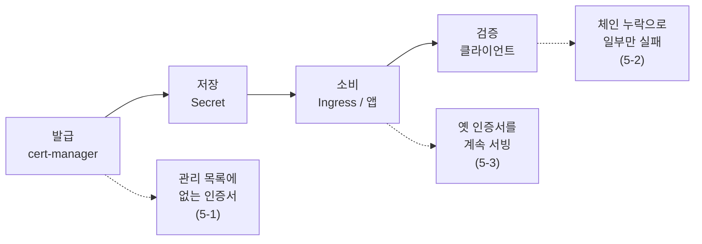
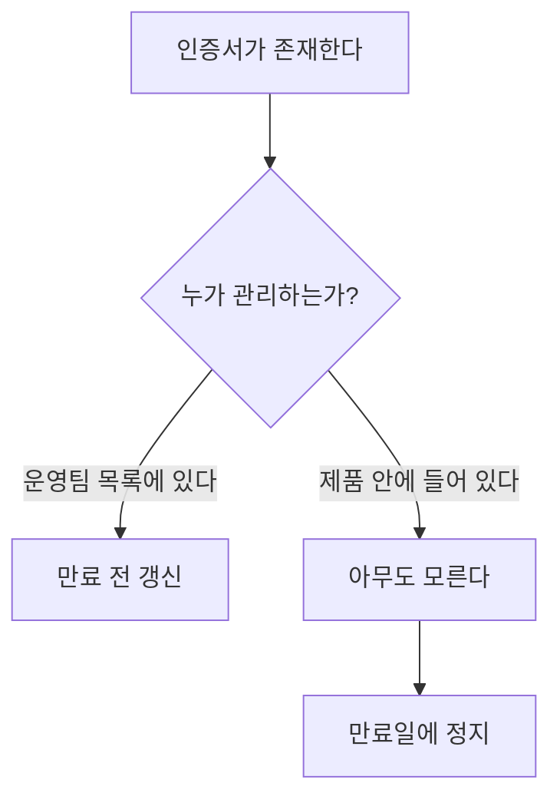
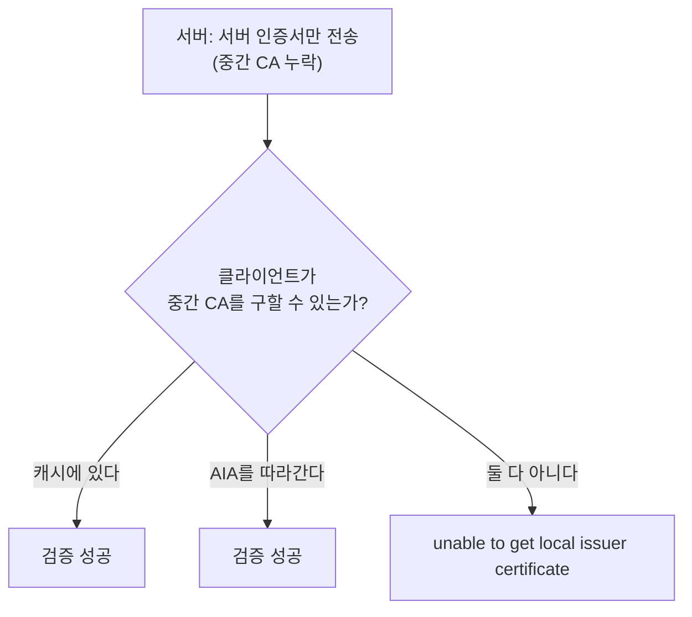
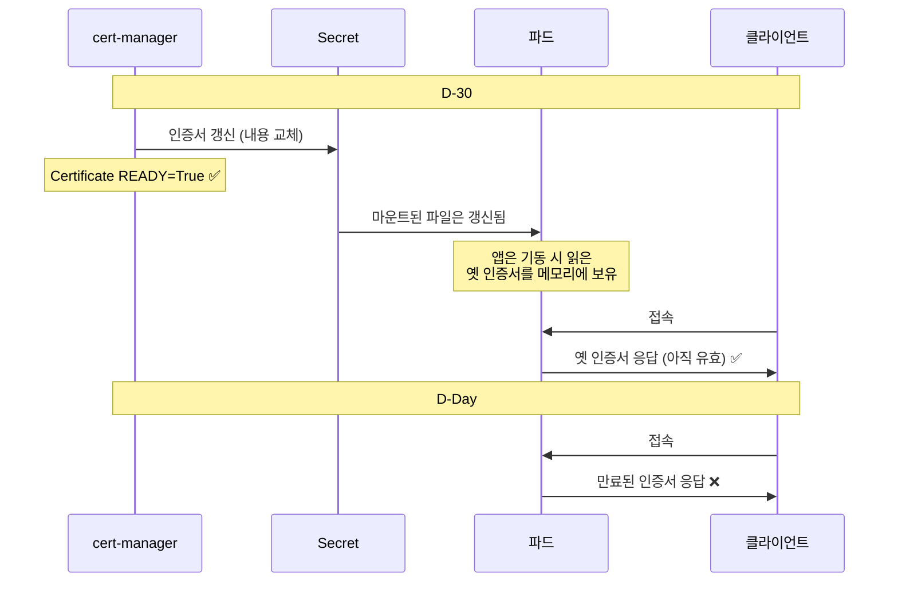

# 5. 인증서로 인한 장애 사례

인증서 장애는 대부분 **발급이 실패해서** 생기지 않는다. 발급은 정상이었고, 그 이후를 아무도 추적하지 않아서 생긴다.



## 5-1. Ericsson — 소프트웨어에 박혀 있던 인증서 (2018)

### 타임라인

| 시각 (UTC) | 상황 |
|---|---|
| 12/6 새벽 | Ericsson 패킷 코어 소프트웨어 내부 인증서 만료 |
| 12/6 오전 | 영국 O2, 일본 소프트뱅크에서 데이터 서비스 중단 시작 |
| 12/6 종일 | 원인 파악. 통신사 고객센터에 문의 폭주 |
| 12/6 밤 | Ericsson이 원인을 인증서 만료로 공개 |
| 12/7 | 소프트웨어 교체 후 순차 복구 |

### 규모

| 항목 | 내용 |
|---|---|
| 영향 국가 | 11개국 |
| 영향 사용자 | 영국 O2에서만 약 3천만 명 |
| 중단 시간 | 약 하루 |
| 원인 | 소프트웨어에 포함된 인증서 하나의 만료 |

### 무엇이 문제였나

만료일은 인증서 안에 정확히 박혀 있었다. 아무도 그것을 보지 않았을 뿐이다.

이 인증서는 웹 서버의 TLS 인증서가 아니라 **패킷 코어 소프트웨어 내부에서 쓰이던 인증서**였다. 벤더가 제품에 담아 납품했고, 통신사 운영팀의 인증서 관리 목록에는 존재하지 않았다.



1-2에서 본 수동 관리의 문제가 극단적으로 나타난 형태다. 그리고 인증서 문제가 웹 서버에만 생기는 것이 아니라는 점을 보여준다. 내부 구성 요소끼리 TLS를 쓰는 곳이라면 어디든 같은 일이 생길 수 있다.

### 참고자료

- [Millions of smartphones were taken offline by an expired certificate — The Verge](https://www.theverge.com/2018/12/7/18130323/ericsson-software-certificate-o2-softbank-uk-japan-smartphone-4g-network-outage)
- [Here's what caused yesterday's O2 and SoftBank outages — TechCrunch](https://techcrunch.com/2018/12/07/heres-what-caused-yesterdays-o2-and-softbank-outages/)
- [Ericsson: Expired certificate caused O2 and SoftBank outages — ZDNET](https://www.zdnet.com/article/ericsson-expired-certificate-caused-o2-and-softbank-outages/)

**연결**: 1-2 등장 배경, 1-5 관리 주체가 없는 인증서

## 5-2. 중간 CA 누락 — 클라이언트마다 결과가 다르다

특정 사건이 아니라 반복해서 나타나는 유형이다.

### 증상

같은 서버에 접속하는데 결과가 갈린다.

| 클라이언트 | 결과 | 이유 |
|---|---|---|
| Chrome, Safari | 성공 | 중간 CA를 캐시했거나 AIA를 따라감 |
| Firefox | 성공 | 자주 쓰이는 중간 CA를 내장 |
| `curl` (Windows/macOS) | 성공 | OS TLS 스택이 AIA를 따라감 |
| `curl` (Linux) | 실패 | OpenSSL은 AIA를 따라가지 않음 |
| Go / Java / Python 클라이언트 | 실패 | 자체 검증 로직, AIA 미지원 |

브라우저로 확인하고 배포했다가 서버 간 연동에서 터지는 전형적인 경로다.

### 왜 갈리는가



2-3에서 본 대로 중간 CA 전송은 서버의 의무다. 일부 클라이언트가 이를 보완해 주기 때문에 설정 오류가 드러나지 않을 뿐이다.

### 확인

```console
$ openssl s_client -connect app.example.com:443 -servername app.example.com
...
Certificate chain
 0 s:CN=app.example.com
   i:C=US, O=Let's Encrypt, CN=R11
 1 s:C=US, O=Let's Encrypt, CN=R11        # ← 이 줄이 없으면 중간 CA 누락
   i:C=US, O=Internet Security Research Group, CN=ISRG Root X1
```

cert-manager를 쓰면 `tls.crt`에 중간 CA가 함께 들어가므로 대개 문제가 없다. 인증서를 수동으로 넣거나, 로드밸런서에 파일을 따로 업로드하는 구성에서 주로 발생한다.

### 참고자료

- [Chain of Trust — Let's Encrypt](https://letsencrypt.org/certificates/)
- [Troubleshooting — cert-manager](https://cert-manager.io/docs/troubleshooting/)

**연결**: 2-3 서버가 보내야 하는 것, AIA

## 5-3. Secret은 갱신됐는데 앱이 옛 인증서를 서빙

쿠버네티스 환경에서 가장 자주 나오는 형태다.

### 경과



### 무엇이 문제였나

**아무도 오류를 내지 않는다는 점**이 문제다.

| 확인 대상 | 상태 |
|---|---|
| `kubectl get certificate` | `READY=True` |
| `Secret`의 `tls.crt` | 최신 인증서 |
| 파드에 마운트된 파일 | 최신 인증서 |
| 실제 응답하는 인증서 | 만료된 옛 인증서 |

모니터링이 `Certificate` 리소스나 `Secret`만 보고 있으면 이 상태를 감지하지 못한다. 만료일이 되어야 드러난다.

### 대응

| 방법 | 내용 |
|---|---|
| 앱에서 리로드 | 인증서 파일 변경을 감지해 다시 읽는 로직을 넣는다 |
| 컨트롤러로 재시작 | `Secret` 변경 시 롤링 재시작을 거는 도구를 쓴다 |
| 엔드포인트 감시 | 리소스가 아니라 실제 접속해서 응답하는 인증서의 만료일을 본다 |

세 번째가 근본적이다. 인증서 관리 상태가 아니라 **클라이언트가 실제로 받는 것**을 봐야 한다.

### 참고자료

- [Securing Ingress Resources — cert-manager](https://cert-manager.io/docs/usage/ingress/)
- [Reloader — Stakater](https://github.com/stakater/Reloader)
- [Secrets — Kubernetes](https://kubernetes.io/docs/concepts/configuration/secret/)

**연결**: 1-5 cert-manager의 역할이 아닌 것

## 5-4. 증상으로 역추적하기

| 증상 | 의심 지점 | 확인 |
|---|---|---|
| 특정 클라이언트에서만 실패 | 중간 CA 누락 | `openssl s_client`로 체인 확인 |
| 브라우저에 다른 도메인 인증서가 보임 | SNI 불일치, 기본 인증서 | 3-2 |
| `READY=True`인데 만료 인증서 응답 | 앱이 재로딩하지 않음 | 5-3 |
| 발급이 `pending`에서 멈춤 | solver 경로 차단 | 1-4 self-check |
| 오래된 기기에서만 실패 | 신뢰 저장소 미갱신 | 2-3 |
| 시간이 맞지 않는 기기에서 실패 | 클라이언트 시계 | 2-2 Validity |

## 5-5. 앞으로의 위험 요인

2026년 3월부터 공인 인증서의 최대 유효기간이 200일로 줄었고, 2029년에는 47일이 된다(1-2 참조).

수동 갱신으로 버티던 곳은 갱신 주기가 연 1회에서 연 8회로 늘어난다. 지금까지 문제가 없었다는 사실이 앞으로도 괜찮다는 근거가 되지 않는다.

- [Ballot SC-081v3: Introduce Schedule of Reducing Validity and Data Reuse Periods — CA/Browser Forum](https://cabforum.org/2025/04/11/ballot-sc081v3-introduce-schedule-of-reducing-validity-and-data-reuse-periods/)
- [SSL/TLS 인증서 유효기간 단축, 우리의 대응 전략 — 교보DTS 기술블로그](https://blog.kyobodts.co.kr/2026/06/30/ssl-tls-%EC%9D%B8%EC%A6%9D%EC%84%9C-%EC%9C%A0%ED%9A%A8%EA%B8%B0%EA%B0%84-%EB%8B%A8%EC%B6%95-%EC%9A%B0%EB%A6%AC%EC%9D%98-%EB%8C%80%EC%9D%91-%EC%A0%84%EB%9E%B5/)
